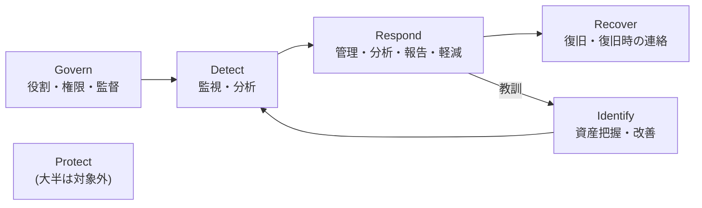

> **文書ID**: OV-002
> **バージョン**: 0.3.0
> **改訂日**: 2026-11-03

# NIST CSF 2.0の使い方

本一式は、NIST CSF 2.0(Govern/Identify/Protect/Detect/Respond/Recover)を、文書の整理と
SOC・CSIRTの機能水準の評価の両方の枠組みとして使う。設計判断の経緯は
[ADR-002](../docs/decisions/ADR-002-scope-and-evaluation.md) を参照。

## 1. 対象範囲

本一式の対象は、NIST SP 800-61 Rev.3のインシデント対応モデルに基づくSOC・CSIRTの機能範囲である。
SP 800-61 Rev.3は、インシデント対応をCSF 2.0の6機能で整理し、Govern・Identify・Protectを準備、
Detect・Respond・Recoverをインシデント対応そのもの、Identifyの改善(ID.IM)を教訓の反映と位置づけている。

本一式では、これを次のように分担する(SOCとCSIRTの分け方は本一式の設計判断。[ADR-003](../docs/decisions/ADR-003-soc-csirt-structure.md))。

| 機能 | SOC | CSIRT |
|---|---|---|
| Detect | 継続的な監視・検知・分析(DE.CM、DE.AE) | ― |
| Respond | 一次評価と初期対応(RS.MA、RS.AN、RS.MI) | 重大インシデントの統制・調整、報告(RS.MA、RS.CO) |
| Recover | ― | 復旧の統制、復旧時の連絡(RC.RP、RC.CO) |
| Identify | 監視対象・保護資産の把握(ID.AM の一部) | 事後レビューによる改善(ID.IM) |
| Govern | 役割・権限・監督(GV.RR、GV.OV)、コンプライアンス監視 | ― |

そのため、主な対象は Detect・Respond・Recover と、それらを支える Govern・Identify の一部になる。
Protect(アクセス制御、データ保護、基盤の堅牢化など)の大半は、準備段階として重要だが本一式の対象外とする。

## 2. 対応関係の置き場所

各文書がどのCSF 2.0カテゴリに対応するかは、
[REC-004 NIST CSF 2.0プロファイル](../05-records-kpi/05-04-nist-csf-profile.md) の1箇所にだけ記載する。
各文書の中には対応表を書かない(重複して内容がずれるのを防ぐため)。

## 3. 評価のしかた

NIST CSF 2.0の本来の使い方に合わせ、次の2つで評価する。

| 評価 | 単位 | 内容 |
|---|---|---|
| プロファイル(Current / Target) | カテゴリ(GV.OC、DE.CMなど22カテゴリ) | 現状と目標を並べ、差分を改善計画にする |
| Tier(Partial〜Adaptive) | 組織全体 | サイバーセキュリティリスクのガバナンスと管理の厳密さを表す |

評価の手順と記入表は [REC-004](../05-records-kpi/05-04-nist-csf-profile.md) を参照。
