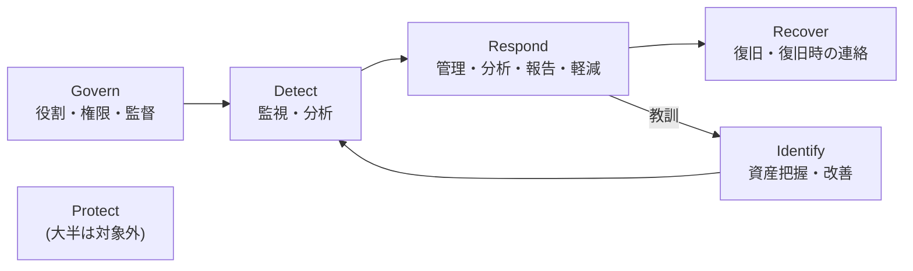

> **文書ID**: OV-002
> **バージョン**: 0.2.0
> **改訂日**: 2026-11-02

# NIST CSF 2.0の使い方

本一式は、NIST CSF 2.0(Govern/Identify/Protect/Detect/Respond/Recover)を、文書の整理と
SOC・CSIRTの機能水準の評価の両方の枠組みとして使う。設計判断の経緯は
[ADR-002](../docs/decisions/ADR-002-scope-and-evaluation.md) を参照。

## 1. 対象範囲

本一式の対象は、Exabeam社の定義に基づくSOC・CSIRTの機能範囲(監視・検知、インシデント管理、
コンプライアンス監視、インシデント対応、再発防止)である。そのため、CSF 2.0の6機能のうち
主な対象は Detect・Respond・Recover と、それらを支える Govern・Identify の一部になる。
Protect(アクセス制御、データ保護、基盤の堅牢化など)の大半は対象外とする。

## 2. 対応関係の置き場所

各文書がどのCSF 2.0カテゴリに対応するかは、
[REC-004 NIST CSF 2.0プロファイル](../05-records-kpi/05-04-nist-csf-profile.md) の1箇所にだけ記載する。
各文書の中には対応表を書かない(重複して内容がずれるのを防ぐため)。

## 3. 評価のしかた

NIST CSF 2.0の本来の使い方に合わせ、次の2つで評価する。

| 評価 | 単位 | 内容 |
|---|---|---|
| プロファイル(Current / Target) | カテゴリ(GV.OC、DE.CMなど22カテゴリ) | 現状と目標を並べ、差分を改善計画にする |
| Tier(Partial〜Adaptive) | 組織全体 | サイバーセキュリティリスクのガバナンスと管理の厳密さを表す |

評価の手順と記入表は [REC-004](../05-records-kpi/05-04-nist-csf-profile.md) を参照。
