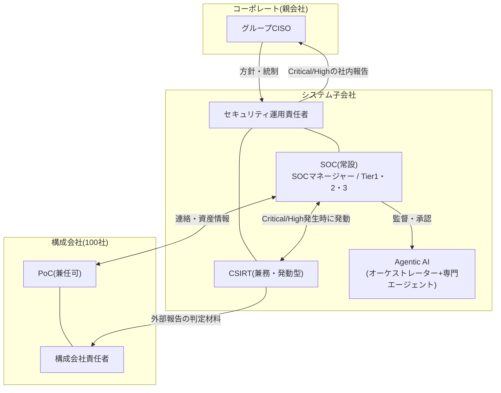

> **文書ID**: GOV-001
> **バージョン**: 0.3.0
> **改訂日**: 2026-11-03

# 組織体制

設計判断の経緯は [ADR-003](../docs/decisions/ADR-003-soc-csirt-structure.md)(SOC・CSIRT体制)と
[ADR-004](../docs/decisions/ADR-004-group-companies.md)(構成会社との関係)を参照。

## 1. 全体像

想定規模は従業員 約1万人 `P-01`、構成会社 100社 `P-02` のグループ企業。

| 主体 | 役割 |
|---|---|
| コーポレート(グループCISO) | グループ全体のセキュリティ方針を定め、システム子会社に運用を委任する。Critical/Highの社内報告を受け、グループ横断の統制(複数社にまたがる外部報告の調整、グループとしての対外説明)を担う。 |
| システム子会社(セキュリティ運用責任者) | グループ専任でSOC・CSIRTを運用する。構成会社から運用を受託する立場にある。 |
| 構成会社責任者 | 自社のセキュリティに責任を持つ。自社が報告義務を負う外部報告の最終承認者([GOV-003](01-03-external-reporting-flow.md))。 |
| 構成会社PoC | SOCとの連絡窓口。資産・ログソース・保護資産の登録、現場での調査協力、利用者への周知を担う。 |

> **カスタマイズ:** 役割の名称と所属は、自組織の職制に合わせて置き換えること。

## 2. SOCの階層とAgentic AIの分担

SOCで一般的な3階層(Tier1/2/3)を基本とし、Agentic AIの導入に合わせてTier1の役割を
「一次評価の実施者」から「AI出力の監督者」に置き換える。

| Tier | 役割 | 主な業務 | 分担するAIエージェント([AI-001](../02-agentic-ai/02-01-architecture.md)) |
|---|---|---|---|
| Tier1 | AI出力の監督者 | トリアージ結果の確認、Lv2措置の事後確認、日次サンプリングレビュー(ケースの引用とカバレッジギャップの確認) | トリアージ・エージェントの判定を監督 |
| Tier2 | インシデントレスポンダー | 深掘り分析と初期対応、判定保留のケースの判断と追加の証拠収集の指示、Lv3措置の起案、夜間・休日のオンコール一次担当 | 調査・分析エージェント群のケースを検証して分析 |
| Tier3 | SME / 脅威ハンター | 複雑な事案の対応、Lv3措置の承認、脅威ハンティング、検知ルールの改善 | 調査・分析エージェントを使って仮説を検証 |
| SOCマネージャー | 日常運用の責任者 | 運用全体の管理、Kill-switchの発動判断 | ― |

Tierの階層はNISTの文書が定めるものではなく、本一式の体制上の区分である。各Tierの業務は、
NIST SP 800-61 Rev.3が示すインシデント対応の役割と、CSF 2.0のDetect・Respondの各カテゴリに対応づけている([OV-002](../00-overview/00-02-nist-csf-usage.md))。

AIエージェントは実行責任(R)を持てるが、説明責任(A)は必ず人間が持つ([GOV-004](01-04-raci.md))。
AIの出力は、証拠の引用とカバレッジギャップを示した「ケース」であり、判定を確定するのは人間である([AI-006](../02-agentic-ai/02-06-evidence-grounded-investigation.md))。

## 3. CSIRTの発動条件と体制

CSIRTはインシデント駆動型の機能とする。平時はTier2/3が「CSIRT機能担当者」として兼務し、
[GOV-002](01-02-severity-matrix.md) でCritical または High と判定された事案で発動する。

| 役割 | 平時の担当 | 発動時の役割 |
|---|---|---|
| インシデントマネージャー | Tier3(兼務) | 対応全体の統括、社内報告、構成会社責任者との調整 |
| フォレンジックアナリスト | Tier2/3(兼務) | 証拠保全、原因分析 |
| 復旧スペシャリスト | Tier2(兼務) | 影響を受けたシステムの復旧 |

### 発動中の監視の継続

CSIRT発動中は兼務者がSOC業務から外れるため、次のとおり監視を継続する。

- 発動に加わらないTier1/2とAIエージェントで監視を続ける。
- 人員が不足する場合は、SOCマネージャーがオンコール要員([GOV-005](01-05-operating-hours.md))を招集する。
- Critical発動中にMedium/Lowの新規事案が発生した場合、初動対応時間目標を超えてもよい。超過した事案は記録に残す。
