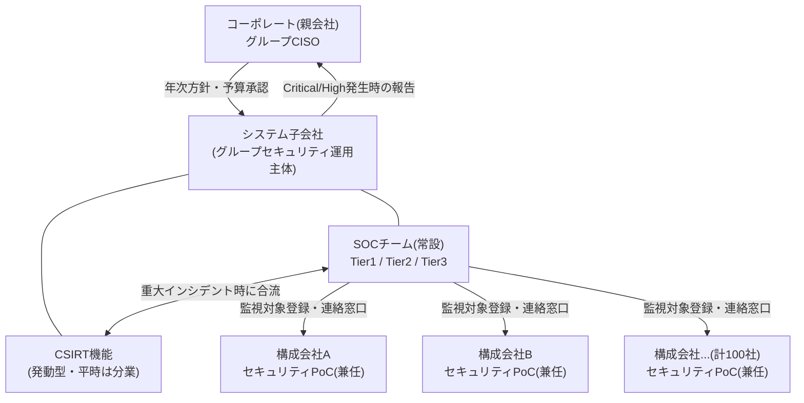

> **文書ID**: GOV-001
> **バージョン**: 0.1.0
> **改訂日**: 2026-11-01

# 組織体制: SOC/CSIRTとグループ内の関係

## 1. 全体像

- **コーポレート(親会社)**: グループ全体のセキュリティ方針を定め、システム子会社に運用を委任する。
  Critical/Highインシデントの報告を受け、必要に応じて対外対応(規制当局・取引先等)の最終承認を行う。
- **システム子会社**: グループ専任でSOC・CSIRTの運用を担う。100社の構成会社に対するセキュリティ運用の
  一元的な実行主体。
- **構成会社(100社)**: 各社にセキュリティ担当のPoC(Point of Contact、兼任可)を置く。SOCからの
  連絡・資産確認・現場でのログ取得協力・利用者への周知等の一次窓口となる。

## 2. SOCの内部階層(Tier構造)

Exabeamが定義するSOCの階層モデルに基づき、以下の3層とする。

| Tier | 役割 | 主な業務 |
|---|---|---|
| Tier 1 | 監視アナリスト | SIEMアラートの一次評価、誤検知のフィルタリング、確認された脅威のエスカレーション |
| Tier 2 | インシデントレスポンダー | Tier1からエスカレートした事案の深掘り分析、初期対応の実施 |
| Tier 3 | SME / 脅威ハンター | 複雑な事案への対応、脅威ハンティング、緩和策・予防策の策定 |

> Agentic AIが各Tierの業務をどの範囲まで代行・支援するか(特にTier1トリアージの自動化)は、
> [`02-agentic-ai/`](../02-agentic-ai/) で詳細に設計する。本文書では組織上の受け皿(Tier構造)のみを
> 定義する。

## 3. CSIRTの発動条件と体制

CSIRTはExabeamの定義に倣い、インシデント駆動型の機能とする。平時はシステム子会社内のTier2/3
アナリストが「CSIRT機能担当者」としてSOC業務と兼務し、重大インシデント発生時に以下の体制で合同
チームとして発動する。

| 役割 | 平時の所属 | 発動時の役割 |
|---|---|---|
| インシデントマネージャー | Tier3 SME(兼務) | 対応全体の統括・コーポレートへの報告 |
| フォレンジックアナリスト | Tier2/3(兼務) | 証拠保全・原因分析 |
| 復旧スペシャリスト | Tier2(兼務) | 影響を受けたシステムの復旧 |

**発動条件**: [重大度・エスカレーション基準(GOV-002)](01-02-severity-and-escalation.md) で
Critical または High と判定された事案。
