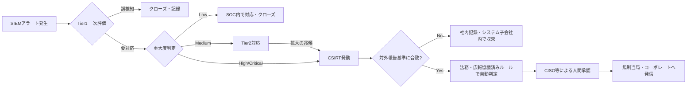

> **文書ID**: GOV-002
> **バージョン**: 0.1.0
> **改訂日**: 2026-11-01

# 重大度分類とエスカレーション基準

## 1. 重大度分類

| 重大度 | 定義 | 初動対応時間目標 | SOC→CSIRTエスカレーション |
|---|---|---|---|
| Critical | 複数の構成会社・基幹システムに影響、または機密情報の大規模漏洩の疑い | 15分以内 | 必須・即時 |
| High | 単一の構成会社の重要システムに影響、または特定区分の情報漏洩の疑い | 1時間以内 | 必須 |
| Medium | 影響範囲が限定的、拡大の可能性がある事案 | 4時間以内 | Tier3判断で任意 |
| Low | 影響が軽微、または既知の誤検知パターンに近い事案 | 1営業日以内 | 不要(SOC内で対応完了) |

本分類は、Exabeam社の解説記事における「SOCからCSIRTへのエスカレーションは、事前定義された
重大度・複雑性の基準を満たした場合に行う」という原則を、具体的な4段階に落とし込んだものである。

## 2. エスカレーションフロー

対外報告の判定・承認の詳細は [外部報告フロー(GOV-003)](01-03-external-reporting-flow.md) を参照。

## 3. 重大度判定の見直し

- 重大度は初期判定から事案の進展に応じて上方修正できるものとし、下方修正はCSIRT発動後は
  インシデントマネージャーの承認を要する。
- 四半期ごとに、実際のインシデント記録(サブプロジェクト6参照)を基に本基準の閾値を見直す。
