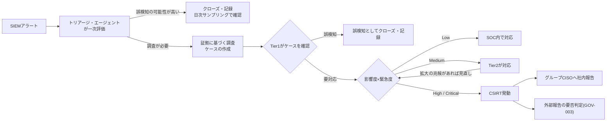

> **文書ID**: GOV-002
> **バージョン**: 0.3.0
> **改訂日**: 2026-11-03

# 重大度マトリクスとエスカレーション基準

重大度の定義は本文書にだけ置く。各Runbookでは、本マトリクスに対するシナリオ固有の補正だけを書く。
設計判断の経緯は [ADR-005](../docs/decisions/ADR-005-severity-matrix.md) を参照。

## 1. 重大度の決め方

重大度は「影響度」と「緊急度」の組み合わせで決める。構成会社の数ではなく、業務と情報への影響で判断する。

### 影響度

| 影響度 | 目安 |
|---|---|
| 大 | 基幹システムの停止、機密情報・個人情報の大規模な漏洩、複数の構成会社への波及 |
| 中 | 単一の構成会社の重要システムへの影響、限定的な情報漏洩、特権アカウントの侵害 |
| 小 | 単一の端末・アカウントにとどまり、業務への影響が軽微 |

### 緊急度

| 緊急度 | 目安 |
|---|---|
| 高 | 攻撃が進行中、または被害が拡大している |
| 中 | 封じ込めていないため、拡大する可能性がある |
| 低 | 封じ込め済み、または拡大の可能性がない |

> **カスタマイズ:** 目安は自組織の業務重要度の分類(基幹システムの定義、情報の格付け)に合わせて具体化すること。

### マトリクス

| 影響度 \ 緊急度 | 高 | 中 | 低 |
|---|---|---|---|
| **大** | Critical | Critical | High |
| **中** | High | High | Medium |
| **小** | Medium | Low | Low |

## 2. 重大度ごとの対応

| 重大度 | 初動対応時間目標 | 対応主体 | 社内報告 |
|---|---|---|---|
| Critical | 15分以内 `P-04` | CSIRT発動(必須) | セキュリティ運用責任者 → グループCISOへ即時 |
| High | 1時間以内 `P-05` | CSIRT発動(必須) | セキュリティ運用責任者 → グループCISOへ当日中 |
| Medium | 4時間以内(有人時間帯) `P-06` | SOC(Tier2)。拡大の兆候があれば重大度を見直す | 月次報告に含める |
| Low | 1営業日以内 `P-07` | SOC内で完結 | 月次報告に含める |

- 初動対応とは、封じ込めの開始または担当者の対応開始を指す。夜間・休日は、AIによるLv1措置と
  オンコール呼び出しを初動とみなす([GOV-005](01-05-operating-hours.md))。
- 社内報告(グループCISOへの報告)は、外部報告の要否にかかわらず必ず行う。
  外部報告は [GOV-003](01-03-external-reporting-flow.md) の別フローで扱う。

## 3. エスカレーションの流れ

一次評価と調査の詳細は [AI-006](../02-agentic-ai/02-06-evidence-grounded-investigation.md) 第2章、日次サンプリングは
[AI-004](../02-agentic-ai/02-04-audit-and-kill-switch.md) を参照。

## 4. 重大度の変更

- 重大度は、事案の進展に応じて随時上げてよい。
- CSIRT発動後に重大度を下げる場合は、インシデントマネージャーの承認を要する。
- 判定と変更の履歴は [REC-001](../05-records-kpi/05-01-incident-record-format.md) に記録する。
- 本マトリクスの目安と初動対応時間目標は、四半期 `P-16` ごとにインシデント記録を基に見直す。

## 5. Runbookでの補正のルール

- 各Runbookは「この条件に該当したら影響度を中以上とする」のように、影響度・緊急度の下限を
  引き上げる補正だけを定義できる。
- マトリクス自体や、重大度を引き下げる補正はRunbookでは定義しない。
