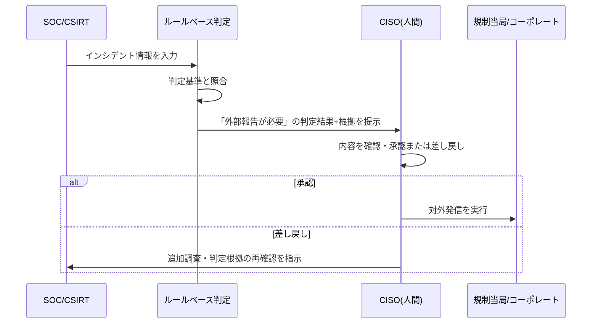

> **文書ID**: GOV-003
> **バージョン**: 0.1.0
> **改訂日**: 2026-11-01

# 外部報告フロー

## 1. 基本方針

- **判定**: 法務・広報と事前協議済みのルールベース基準(影響を受けた個人情報件数、業種別の
  規制報告義務、取引先への契約上の通知義務など)により、「外部報告が必要か」をシステム的に
  自動判定する。
- **発信**: 判定が「必要」となった場合でも、規制当局・コーポレートへの実際の対外発信は、
  CISO等の人間による最終承認を必須とする(Human-in-the-loop)。誤判定による誤通報のリスクを
  人間のレビューで吸収する。

Agentic AIがこの判定ロジックにどこまで関与するか(判定根拠の生成、ドラフト作成支援等)の技術的な
実装方針は、[`02-agentic-ai/`](../02-agentic-ai/) で詳細化する。本文書はガバナンス上の
権限・責任の切り分けのみを定める。

## 2. 判定基準(例)

| 基準カテゴリ | 例 |
|---|---|
| 個人情報漏洩の規模 | 一定件数以上の個人情報が漏洩した疑いがある場合 |
| 業法上の報告義務 | 構成会社が属する業種の規制当局への報告義務に該当する場合 |
| 契約上の通知義務 | 取引先・顧客との契約で定める通知義務に該当する場合 |
| 事業継続への影響 | グループ複数社の基幹システムが停止し、対外的な説明が必要な場合 |

> 実際の運用では、上記を自組織の法務部門と協議の上、具体的な数値基準・対象法令に置き換えること。

## 3. 承認フロー

## 4. 記録

外部報告の判定結果・承認記録は、[記録フォーマット(サブプロジェクト6)](../05-records-kpi/) で
定める形式で必ず保存する。
