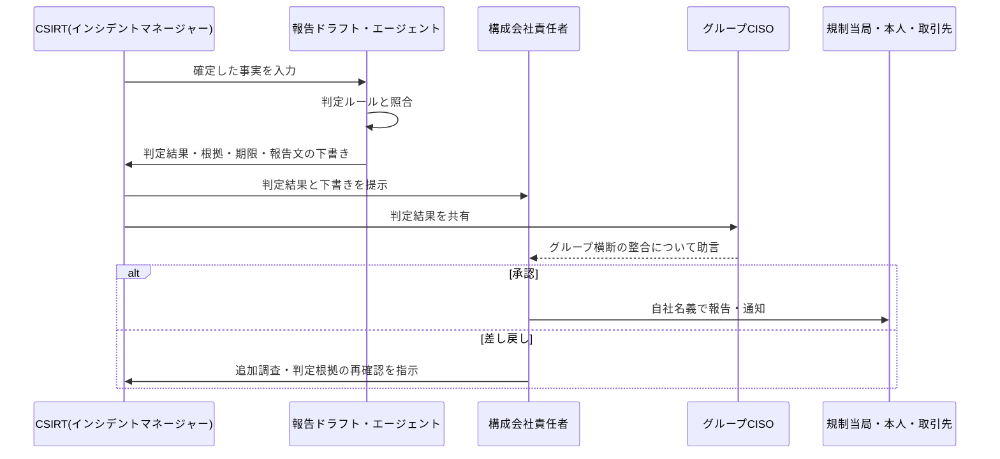

> **文書ID**: GOV-003
> **バージョン**: 0.2.0
> **改訂日**: 2026-11-02

# 外部報告フロー

規制当局・取引先・本人など、グループ外への報告・通知を扱う。グループ内の報告(グループCISOへの
社内報告)は [GOV-002](01-02-severity-matrix.md) で扱い、本フローの対象外とする。
設計判断の経緯は [ADR-006](../docs/decisions/ADR-006-external-reporting.md) を参照。

## 1. 基本方針

- **報告主体は各構成会社**: 個人情報保護法などの報告義務は法人ごとに課される。そのため、外部報告の
  主体は被害を受けた構成会社とし、最終承認は構成会社責任者が行う。
- **判定は自動、発信は人間**: 外部報告が必要かどうかは、法務・広報と事前に合意したルールで自動判定する。
  実際の報告・通知は、必ず人間の承認を経て行う。AIは報告文の下書きまでを担い、送信はしない
  ([AI-002](../02-agentic-ai/02-02-authority-levels.md) の「AIが実行しない操作」)。
- **グループCISOは統制**: 複数の構成会社が同時に報告する場合の内容・時期の整合、グループとしての
  対外説明の調整を担う。

## 2. 役割

| 役割 | 担うこと |
|---|---|
| CSIRT(インシデントマネージャー) | 判定に必要な事実(件数、データの種類、原因)の確定、判定結果の確認 |
| 報告ドラフト・エージェント | ルールによる判定の実行、判定根拠の整理、報告文の下書き |
| 構成会社責任者 | 報告内容の最終承認、報告の実施(自社名義) |
| グループCISO | グループ横断の整合性の確認、コーポレートとしての対外説明の判断 |
| 法務・広報 | 判定ルールの維持、報告文・公表文の確認 |

システム子会社が構成会社から個人データの取扱いを受託している場合、システム子会社は委託先として、
委託元である構成会社に速やかに事実を通知する。

## 3. 判定基準と報告期限(例)

| 区分 | 判定基準の例 | 報告先の例 | 期限の例 |
|---|---|---|---|
| 個人情報の漏えい等 | 要配慮個人情報を含む、財産的被害のおそれがある、不正の目的によるおそれがある、1,000人を超える、のいずれか | 個人情報保護委員会、本人 | 速報: 把握後速やかに(概ね3〜5日以内)。確報: 30日以内(不正の目的によるおそれがある場合は60日以内) |
| 業法上の報告義務 | 構成会社の業種を所管する官庁が定める報告対象事案に該当 | 所管官庁 | 各業法・ガイドラインの定めによる |
| 契約上の通知義務 | 取引先・顧客との契約で定める通知対象に該当 | 取引先・顧客 | 契約の定めによる |
| 社会的影響 | サービス停止などで対外的な説明が必要 | 報道機関・利用者(公表) | 広報方針による |

> **カスタマイズ:** 上表は日本の個人情報保護法を例にした記載である。法令・ガイドラインは改正される
> ことがあるため、導入時に最新の条文・ガイドラインを法務部門と確認し、対象となる業法・契約・
> 海外拠点の法令(GDPRなど)を加えること。

## 4. フロー

報告期限が迫っている場合、事実が確定していなくても、判明している範囲で速報を行う。

## 5. 記録

判定結果、判定日時、報告主体、承認者、承認日時、報告先、報告日時(速報・確報)を
[REC-001](../05-records-kpi/05-01-incident-record-format.md) に記録する。
