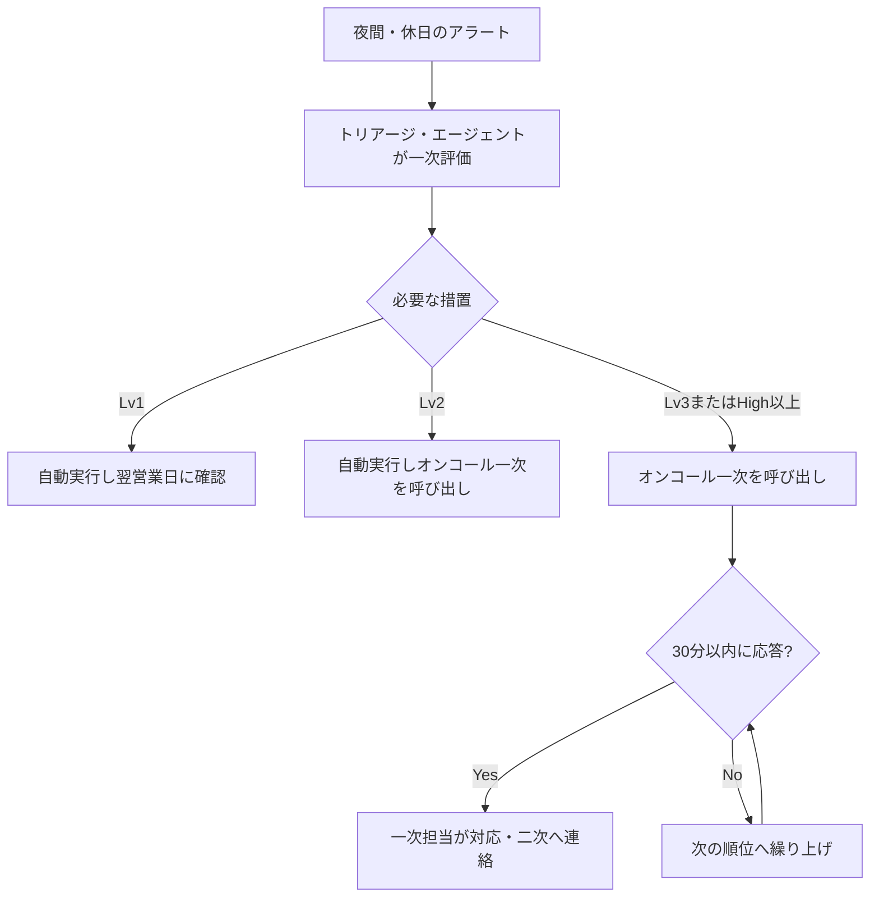

> **文書ID**: GOV-005
> **バージョン**: 0.1.0
> **改訂日**: 2026-11-02

# 運用時間とオンコール体制

平日日中は有人で運用し、夜間・休日はAgentic AIを主体にオンコールで補う。
設計判断の経緯は [ADR-009](../docs/decisions/ADR-009-operating-hours.md) を参照。

## 1. 時間帯ごとの体制

| 項目 | 有人時間帯(平日 9:00〜18:00 `P-03`) | 夜間・休日 |
|---|---|---|
| 監視・一次評価 | トリアージ・エージェント+Tier1が確認 | トリアージ・エージェントのみ。翌営業日にTier1がまとめて確認 |
| Lv1措置 | 自動実行 | 自動実行 |
| Lv2措置 | 自動実行後、Tier1が15分以内 `P-11` に確認 | 自動実行後、オンコール一次担当が30分以内 `P-08` に確認 |
| Lv3措置 | [AI-002](../02-agentic-ai/02-02-authority-levels.md) の承認者が承認 | オンコール経由で承認者を呼び出す |
| Critical / High | CSIRT発動 | オンコール一次担当がインシデントマネージャーを呼び出し、CSIRT発動 |
| Medium / Low | 通常どおり対応 | 翌営業日に対応(夜間に重大度が上がった場合は上段に従う) |

夜間・休日の初動は、AIによるLv1措置とオンコールの呼び出しとする([GOV-002](01-02-severity-matrix.md) 第2章)。

## 2. オンコール体制

| 順位 | 担当 | 呼び出す条件 |
|---|---|---|
| 一次 | Tier2(当番制) | Lv2措置の実行、Lv3措置の起案が必要、High以上の判定、AIの異常検知アラート |
| 二次 | Tier3またはインシデントマネージャー(当番制) | Lv3措置の承認、CSIRT発動 |
| 三次 | SOCマネージャー | 一次・二次が応答しない、Kill-switchの発動判断 |

- 呼び出しから30分 `P-08` 以内に応答がない場合は、次の順位に繰り上げて呼び出す。
- 夜間・休日にLv3措置の承認者に連絡がつかない場合、AIはLv3措置を実行しない。
  Lv1の範囲でできる封じ込めを続け、オンコールの呼び出しを繰り返す。

## 3. 引継ぎ

有人時間帯の開始時と終了時の引継ぎ手順は [SOC-051](../03-soc-runbooks/03-51-daily-operations.md) に定める。
