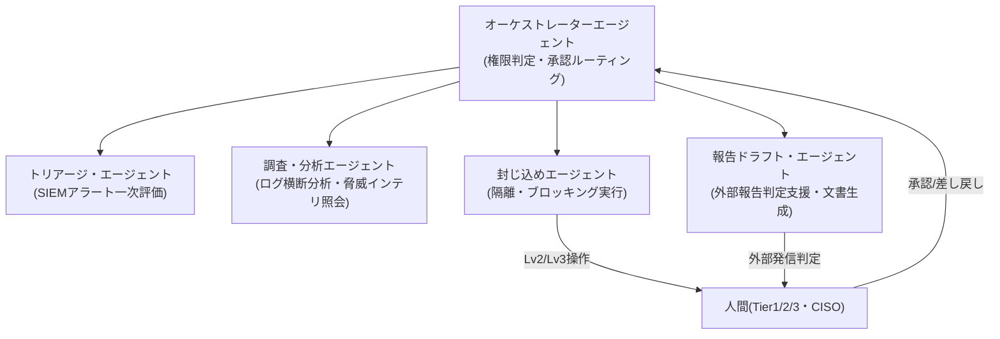

> **文書ID**: AI-001
> **バージョン**: 0.1.0
> **改訂日**: 2026-11-02

# Agentic AIアーキテクチャ

オーケストレーターエージェントが全体を制御し、役割ごとに専門化したシングルタスクエージェントの
プールにタスクを振り分ける構成を前提とする。

## 権限の最小化

各専門エージェントのツールアクセス権限は最小化する。

| エージェント | アクセス可能なツール範囲 |
|---|---|
| トリアージ・エージェント | SIEM検索・アラート参照(読み取りのみ) |
| 調査・分析エージェント | ログ横断検索、脅威インテリジェンス照会(読み取りのみ) |
| 封じ込めエージェント | 隔離・ブロッキング系API(書き込み・[権限レベル(AI-002)](02-02-authority-levels.md)に従う) |
| 報告ドラフト・エージェント | 文書生成ツール、[外部報告フロー(GOV-003)](../01-governance/01-03-external-reporting-flow.md)の判定ロジック参照 |

オーケストレーターは、[権限レベル判定(AI-002)](02-02-authority-levels.md)と
[判断ログ記録(AI-003)](02-03-decision-logging.md)を一元管理する。
