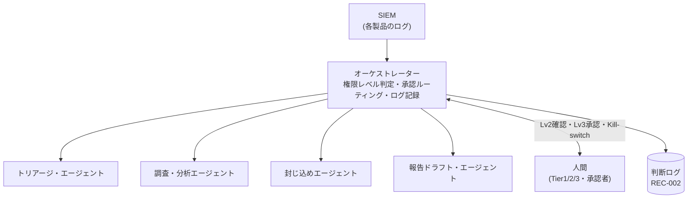

> **文書ID**: AI-001
> **バージョン**: 0.2.0
> **改訂日**: 2026-11-02

# Agentic AIアーキテクチャ

オーケストレーターが全体を制御し、役割ごとに専門化したエージェントにタスクを振り分ける。
設計判断の経緯は [ADR-007](../docs/decisions/ADR-007-agent-architecture.md) を参照。

## 1. エージェントと人間の分担

| エージェント | 担うこと | ツール権限 | 監督する人間 |
|---|---|---|---|
| トリアージ・エージェント | アラートの一次評価、影響度・緊急度の仮判定 | SIEMの検索・参照(読み取りのみ) | Tier1 |
| 調査・分析エージェント | ログの横断分析、脅威インテリジェンスの照会、脅威ハンティングの検索 | ログ検索、脅威インテリジェンス照会(読み取りのみ) | Tier2/3 |
| 封じ込めエージェント | 隔離・遮断などの措置の実行 | 隔離・遮断系API([AI-002](02-02-authority-levels.md) の範囲に限る) | 措置ごとの承認者 |
| 報告ドラフト・エージェント | 外部報告の要否判定、報告文の下書き | 文書作成、判定ルールの参照(送信機能は持たない) | インシデントマネージャー |

> **カスタマイズ:** エージェントの分割単位とツール権限は、利用するAgentic AI SOC基盤の機能に合わせて
> 置き換えること。読み取り系と書き込み系のエージェントを分ける原則は維持することを推奨する。

## 2. オーケストレーターの責務

- 各措置の権限レベルを [AI-002](02-02-authority-levels.md) の規則で判定する。エージェント自身には判定させない。
- Lv2の確認依頼、Lv3の承認依頼を、時間帯に応じた担当者([GOV-005](../01-governance/01-05-operating-hours.md))に送る。
- すべての判定と実行を判断ログ([AI-003](02-03-decision-logging.md))に記録する。
- Kill-switch([AI-004](02-04-audit-and-kill-switch.md))が有効な間は、すべての措置をLv3として扱う。

## 3. エージェントの識別と権限管理

- エージェントごとに専用のサービスアカウント(非人間ID)を割り当て、人間のアカウントと共用しない。
- 認証情報は有効期限の短いものを使い、エージェントの操作ログはSIEMに取り込んで監視する。
- AI固有の脅威への対策は [AI-005](02-05-ai-specific-threats.md) を参照。
