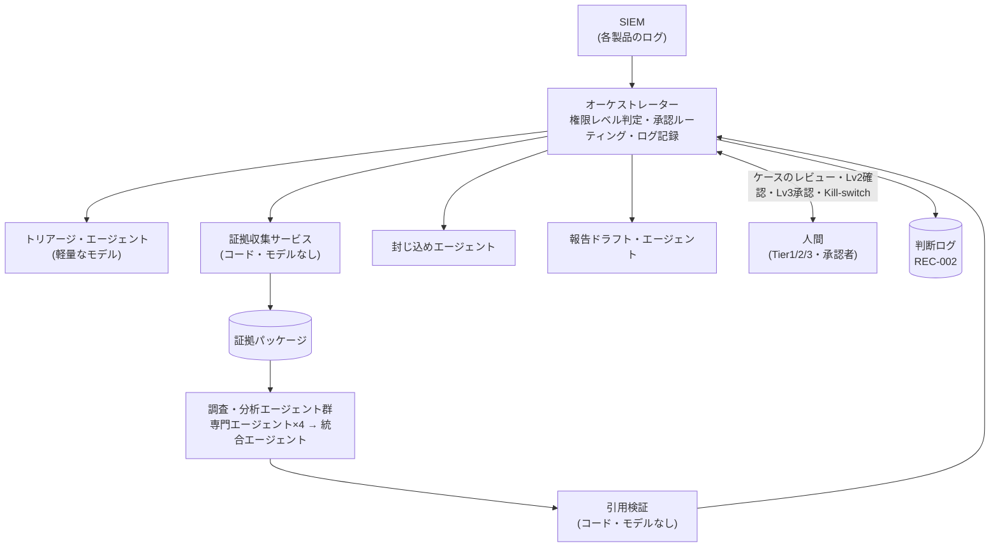

> **文書ID**: AI-001
> **バージョン**: 0.3.0
> **改訂日**: 2026-11-03

# Agentic AIアーキテクチャ

オーケストレーターが全体を制御し、役割ごとに専門化したエージェントにタスクを振り分ける。
調査では、証拠の収集(決定的な処理)とモデルによる推論を分け、すべての所見を証拠に基づかせる
([AI-006](02-06-evidence-grounded-investigation.md))。
設計判断の経緯は [ADR-007](../docs/decisions/ADR-007-agent-architecture.md)、
[ADR-013](../docs/decisions/ADR-013-evidence-grounded-investigation.md) を参照。

## 1. 構成要素と人間の分担

### モデルを使わない構成要素

| 構成要素 | 担うこと | 権限 |
|---|---|---|
| オーケストレーター | 処理の制御、権限レベルの判定、承認のルーティング、判断ログの記録 | 各エージェントの呼び出し |
| 証拠収集サービス | Runbookの証拠の定義に従い、決められたクエリで証拠を集め、証拠パッケージを作る。調査範囲(構成会社・アセット・期間・ログソース)を強制する | SIEM・資産台帳・脅威インテリジェンスの参照(読み取りのみ) |
| 引用検証 | 統合エージェントの出力の引用・範囲・値・語彙を検証する | 証拠パッケージの参照(読み取りのみ) |

### AIエージェント

| エージェント | 担うこと | ツール権限 | 監督する人間 |
|---|---|---|---|
| トリアージ・エージェント | アラートの一次評価(誤検知の可能性が高いか、調査が必要か)。軽量なモデルを使う | アラートと除外条件の参照(読み取りのみ) | Tier1 |
| 調査・分析エージェント群 | 下表の専門エージェントと統合エージェントの総称。各Runbookの「調査・分析エージェント」はこの群を指す | 証拠パッケージの参照のみ(新たな証拠の取得はしない) | Tier2/3 |
| 封じ込めエージェント | 隔離・遮断などの措置の実行 | 隔離・遮断系API([AI-002](02-02-authority-levels.md) の範囲に限る) | 措置ごとの承認者 |
| 報告ドラフト・エージェント | 外部報告の要否判定、報告文の下書き | 文書作成、判定ルールの参照(送信機能は持たない) | インシデントマネージャー |

### 調査・分析エージェント群の内訳

| エージェント | 担うこと |
|---|---|
| テレメトリ分析エージェント | 対象の構成会社のログの分析 |
| 資産・ユーザーコンテキスト・エージェント | 資産の重要度、利用者の属性、出張・変更管理の記録との照合 |
| グループ横断テレメトリ・エージェント | 同じIoC・手口の他の構成会社での出現を、集約値だけで分析 |
| 脅威インテリジェンス・エージェント | IoC・手口と既知の脅威情報の照合 |
| 統合エージェント | 専門エージェントの所見を統合し、判定語彙の範囲で判定区分と推奨を出す |

各エージェントの制約、判定語彙、引用検証の規則は [AI-006](02-06-evidence-grounded-investigation.md) に定める。

> **カスタマイズ:** エージェントの分割単位とツール権限は、利用するAgentic AI SOC基盤の機能に合わせて
> 置き換えること。次の3つの原則は維持することを推奨する。
> (1) 読み取り系と書き込み系のエージェントを分ける。
> (2) 証拠の収集はモデルではなくコードで行い、調査範囲をコードで強制する。
> (3) 所見の引用をコードで検証してから人間に渡す。

## 2. オーケストレーターの責務

- 各措置の権限レベルを [AI-002](02-02-authority-levels.md) の規則で判定する。エージェント自身には判定させない。
- 引用検証に合格しなかったケース、判定保留のケースからは、Lv1・Lv2の措置を実行しない([AI-002](02-02-authority-levels.md) 第2章)。
- Lv2の確認依頼、Lv3の承認依頼を、時間帯に応じた担当者([GOV-005](../01-governance/01-05-operating-hours.md))に送る。
- すべての判定と実行を判断ログ([AI-003](02-03-decision-logging.md))に記録する。
- Kill-switch([AI-004](02-04-audit-and-kill-switch.md))が有効な間は、すべての措置をLv3として扱う。

## 3. エージェントの識別と権限管理

- エージェントごとに専用のサービスアカウント(非人間ID)を割り当て、人間のアカウントと共用しない。
- 調査・分析エージェント群には、SIEMや資産台帳への直接のアクセス権を与えない。証拠は証拠収集サービスを通じてだけ受け取る。
- 認証情報は有効期限の短いものを使い、エージェントの操作ログはSIEMに取り込んで監視する。
- AI固有の脅威への対策は [AI-005](02-05-ai-specific-threats.md) を参照。
