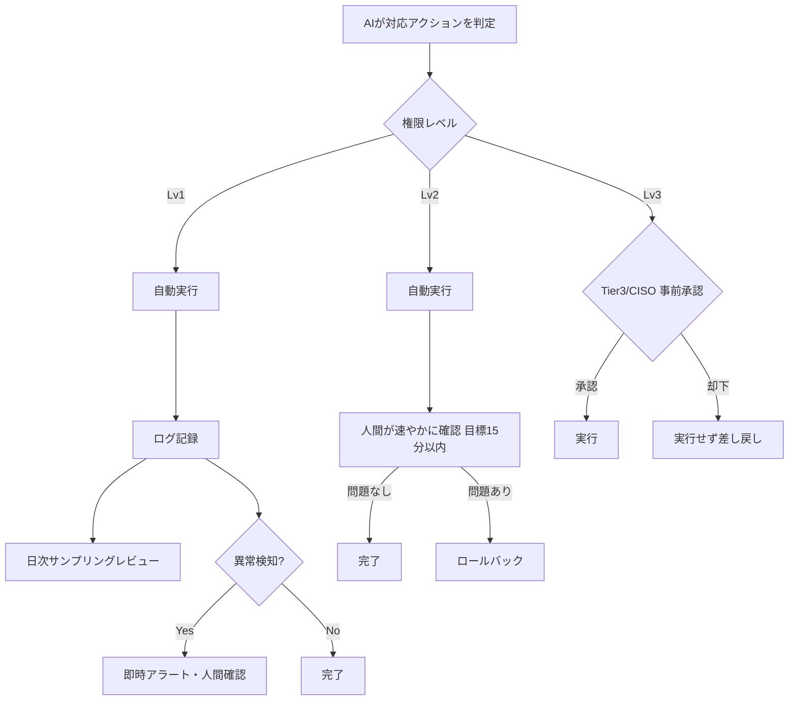

> **文書ID**: AI-002
> **バージョン**: 0.1.0
> **改訂日**: 2026-11-02

# 権限レベルとHuman-in-the-loopフロー

## 1. 権限レベル

AIエージェントが実行する操作を、以下の3段階に分類する。

| レベル | 定義 | 操作例 |
|---|---|---|
| Lv1(自動実行) | 単一対象・可逆的な封じ込め | 単一エンドポイントの隔離、単一IP/ファイルハッシュのブロック、単一アカウントの一時的なセッション無効化 |
| Lv2(事後承認) | 複数対象に及ぶが比較的可逆的 | 複数エンドポイントの一括隔離、部署単位のアカウント一時停止 |
| Lv3(事前承認必須) | 影響が大きい・不可逆性が高い | 本番システムの停止、大量アカウントの無効化、外部通信の全体遮断、対外発信 |

> 実際の運用では、上記の操作例を自組織のアセット分類・システム重要度に応じて具体化すること。

## 2. Human-in-the-loopフロー

異常検知の基準例: 同一対象への短時間での繰り返し実行、AIの判定信頼度が閾値未満、過去に誤判定が
記録されたパターンとの類似。

関連: [判断ログ記録(AI-003)](02-03-decision-logging.md)、
[監査・緊急停止(AI-004)](02-04-audit-and-kill-switch.md)
