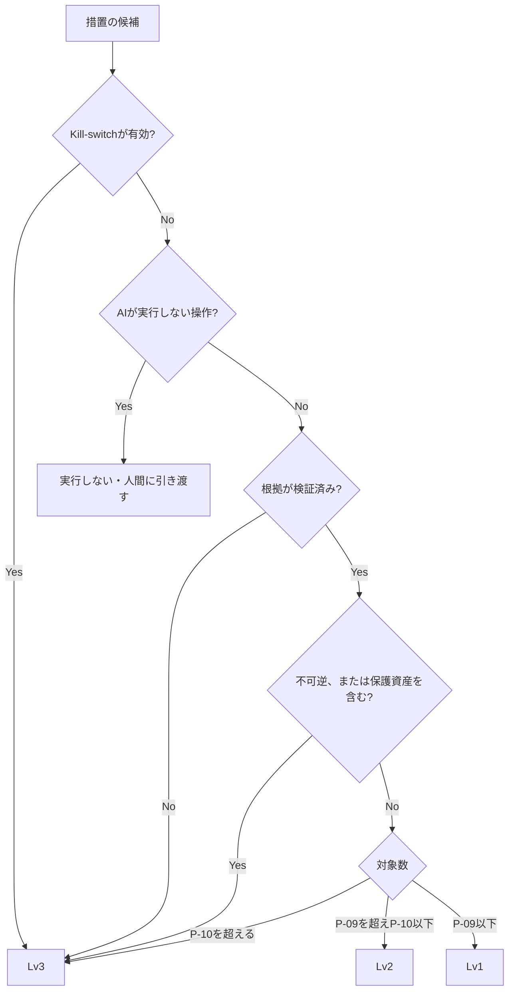

> **文書ID**: AI-002
> **バージョン**: 0.3.0
> **改訂日**: 2026-11-03

# 権限レベルと承認

AIが実行する措置の権限レベルと承認者は、本文書にだけ定義する。各Runbookでは、本文書の規則を
シナリオの措置に当てはめた結果だけを書く。設計判断の経緯は
[ADR-008](../docs/decisions/ADR-008-ai-authority-levels.md) を参照。

## 1. 権限レベル

| レベル | 実行の条件 | 人間の関与 |
|---|---|---|
| Lv1(自動実行) | 根拠が検証済みで、可逆的で、対象数が 1 `P-09` 以下、保護資産を含まない | 実行後に記録。日次サンプリングで確認([AI-004](02-04-audit-and-kill-switch.md)) |
| Lv2(事後承認) | 根拠が検証済みで、可逆的で、対象数が 10 `P-10` 以下、保護資産を含まない | 実行後、有人時間帯は15分以内 `P-11`、夜間・休日は30分以内 `P-08` に人間が確認し、問題があれば元に戻す |
| Lv3(事前承認) | 上記以外 | 実行前に承認者の承認が必須 |

## 2. 判定の規則

オーケストレーターは、措置ごとに次の順で判定する。最初に当てはまったものを採用する。

既定値は `P-09` = 1、`P-10` = 10([OV-004](../00-overview/00-04-customization-points.md))。

### 根拠が検証済みであることの条件

次をすべて満たす場合に「根拠が検証済み」とする。規則の詳細は [AI-006](02-06-evidence-grounded-investigation.md)。

- 措置を推奨したケースが引用検証に合格し、判定区分が「判定保留」でない。
- 該当Runbook第7章でその措置に必要とした証拠が、すべて「確認済み」で、措置を推奨した所見から引用されている。
- 措置が、該当Runbookの対応手順に記載された措置である。

満たさない場合は、措置を取りやめるのではなく、Lv3として承認者に判断を求める(証拠が不足していても、
人間が状況から措置を必要と判断できるようにするため)。

### 対象数の数え方

- 端末・アカウント・クラウドリソースへの措置は、その台数・件数を数える。
- ファイルハッシュ・URL・IPアドレス・メールなどの脅威指標(IoC)を遮断・隔離する措置は、
  影響が局所的で元に戻しやすいため、IoC 1件を1対象と数える(例: 同じフィッシングメールを
  50人の受信箱から隔離する措置は1対象)。
- ただし、IoCが業務上必須の通信先(許可リストに登録済みのドメイン・IPなど)に該当する場合は保護資産として扱う。

## 3. 保護資産

停止すると業務への影響が大きい資産は、対象数にかかわらずLv3とする。

| 区分 | 例 |
|---|---|
| 認証・基盤 | ドメインコントローラ、IDプロバイダ、DNS、DHCP |
| 基幹業務 | 基幹業務システム、本番稼働中のサービスに紐づくサーバー・クラウドリソース |
| 制御系 | OT・制御系の機器 |
| セキュリティ基盤 | SIEM、EDR管理サーバー、Agentic AI SOC基盤そのもの |
| 業務上必須の通信先 | 許可リストに登録済みのドメイン・IPアドレス |

- 保護資産リストは、構成会社PoCの登録を基にSOCが管理し、四半期 `P-24` ごとに棚卸しする([SOC-051](../03-soc-runbooks/03-51-daily-operations.md))。
- クラウドリソースは、本番・検証などの区分をタグで識別できるようにしておく。

> **カスタマイズ:** 保護資産の区分は、自組織の業務重要度の分類に合わせて置き換えること。

## 4. AIが実行しない操作

次の操作は、権限レベルにかかわらずAIは実行しない。AIは判定と下書きまでを行い、人間に引き渡す。

- 外部への報告・通知・公表([GOV-003](../01-governance/01-03-external-reporting-flow.md))
- データ・メール・ログの削除(隔離・移動は可)
- 人事上の措置に関わる操作(内部不正の疑いがある従業員のアカウント停止など。[SOC-005](../03-soc-runbooks/03-05-insider-threat.md))
- 保護資産リスト、権限レベルの規則、判断ログ自体の変更
- 証拠パッケージ、判定語彙、Runbookの証拠の定義の変更([AI-006](02-06-evidence-grounded-investigation.md))

## 5. 承認者

| 措置の範囲 | 承認者(Lv3) | Lv2の事後確認者 |
|---|---|---|
| 単一の構成会社内 | Tier3(CSIRT発動中はインシデントマネージャー) | Tier1(夜間・休日はオンコール一次) |
| 複数の構成会社に影響 | セキュリティ運用責任者 | Tier2 |
| Kill-switch有効中 | 上記と同じ | ―(Lv2は発生しない) |

## 6. 措置の継続判断

- Lv1・Lv2で実施した措置(隔離・遮断など)は、24時間 `P-12` 以内に人間が継続するか解除するかを判断する。
- 期限までに判断されない措置は、自動で解除しない(解除すると再び被害が出るおそれがあるため)。
  期限切れとしてSOCマネージャーに通知する。
