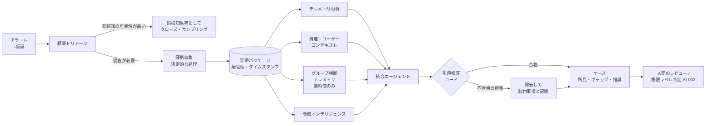

> **文書ID**: AI-006
> **バージョン**: 0.1.0
> **改訂日**: 2026-11-03

# 証拠に基づく調査(証拠パッケージと検証)

AIエージェントの判定と措置の推奨を、決定的な処理で集めた証拠だけに基づかせるための規則を定める。
エージェントの構成は [AI-001](02-01-architecture.md)、設計判断の経緯は
[ADR-013](../docs/decisions/ADR-013-evidence-grounded-investigation.md) を参照。

## 1. 基本原則

| # | 原則 | 理由 |
|---|---|---|
| 1 | **検知は仮説であり、事実ではない。** アラートは「調べるべき問い」として扱い、攻撃が成功した・発生したことの証明とみなさない | アラートの文言をそのまま結論にすると、誤検知をそのまま措置につなげてしまう |
| 2 | **証拠の収集と推論を分ける。** 証拠は、モデルではなくアプリケーションのコード(決定的な処理)が、決められたクエリで集める | モデルに自由に検索させると、対象外のアカウント・期間・ログを参照する(調査範囲の逸脱) |
| 3 | **調査範囲はコードで強制する。** 対象の構成会社・アセット・期間・ログソースを証拠パッケージに固定し、範囲外のデータはエージェントに渡さない | 範囲の判断をモデルに任せると、プロンプトインジェクションや誤りで範囲が広がる |
| 4 | **すべての所見に引用を付け、コードで検証する。** 所見は証拠パッケージ内の項目IDを引用し、引用の存在と内容の一致をコードが確認する | 証拠に裏付けられない主張(ハルシネーション)を人間に届く前に取り除く |
| 5 | **「未確認」と「確認済み・該当なし」を区別する。** 調べられなかった項目はカバレッジギャップとして明示する | ログの途絶や権限不足を「痕跡なし」と誤認すると、侵害を見逃す |
| 6 | **証拠が足りなければ判定しない。** 必要な証拠がそろわない場合、AIは判定区分も措置も推奨せず「判定保留」として人間に引き渡す | 不十分な証拠での推測は、人間に誤った確信を与える |
| 7 | **最終的な判断は人間が持つ。** AIの出力は、引用付きの所見・明示されたギャップ・推奨する次の手順をまとめた「ケース」であり、人間がそれを検証して判断する | 説明責任(A)は人間が持つ([GOV-004](../01-governance/01-04-raci.md)) |

## 2. 調査の流れ

| 段階 | 実行するもの | 入力 | 出力 | モデルの関与 |
|---|---|---|---|---|
| 1. 軽量トリアージ | トリアージ・エージェント(軽量なモデル) | アラート、除外条件 | 「誤検知の可能性が高い」/「調査が必要」 | あり |
| 2. 証拠収集 | 証拠収集サービス(コード) | アラート、Runbookの証拠の定義(各Runbook第7章) | 証拠パッケージ | なし |
| 3. 専門分析 | 専門エージェント(並列) | 証拠パッケージのうち担当範囲のみ | 引用付きの所見 | あり(新たな証拠の取得は不可) |
| 4. 統合 | 統合エージェント | 専門エージェントの所見、証拠パッケージ | 判定区分、推奨、根拠 | あり(新たな証拠の取得は不可、判定語彙の外の区分は不可) |
| 5. 引用検証 | 検証処理(コード) | 統合結果、証拠パッケージ | 検証済みのケース | なし |
| 6. 判断 | 人間、オーケストレーター | ケース | 判定の確定、措置の権限レベル判定([AI-002](02-02-authority-levels.md)) | なし |

- 段階1で「誤検知の可能性が高い」としたアラートは、段階2以降を行わずにクローズできる。クローズした件は
  日次サンプリングレビューの対象とする([AI-004](02-04-audit-and-kill-switch.md))。クローズした件も、
  インシデント記録([REC-001](../05-records-kpi/05-01-incident-record-format.md))の「誤検知時も必須」の項目を記録する(誤検知率の算出に使うため)。
- 保護資産([AI-002](02-02-authority-levels.md) 第3章)に関するアラートと、ランサムウェアの前兆([SOC-004](../03-soc-runbooks/03-04-ransomware-precursor.md))・
  内部不正の疑い([SOC-005](../03-soc-runbooks/03-05-insider-threat.md))のアラートは、段階1でクローズしない。

## 3. 証拠パッケージ

証拠収集サービスが、モデルを動かす前に作る。作成後は変更せず、追加の収集が必要になった場合は新しい版を作る。

| 項目 | 内容 |
|---|---|
| パッケージID・版 | 一意の識別子と版番号(例: `EVP-2026-00001 v1`) |
| 調査対象(サブジェクト) | 元のアラートID、検知ルール、仮説(何を確かめるか) |
| 調査範囲 | 対象の構成会社、アセット・アカウント、ログソース |
| 時間の基準点 | 基準時刻(アラートの発生時刻)と、収集した期間。既定は基準時刻の前72時間から収集時点まで `P-27` |
| 採用した証拠 | 証拠項目の一覧。各項目に項目ID、取得元、取得クエリの識別子、取得時刻、内容(またはハッシュと格納場所)を持つ |
| 適用した規則の版 | 除外条件・保護資産リスト・判定語彙・Runbookの版 |
| 証拠の取得元 | 参照したログソース・資産台帳・脅威インテリジェンスの一覧 |
| カバレッジギャップ | 収集できなかった項目と、その理由(第4章) |

- エージェントに渡すときは、証拠の内容を「データ」として指示と分けて渡す([AI-005](02-05-ai-specific-threats.md))。
- 証拠パッケージは判断ログと同じ要件(改ざん防止、保存期間)で保存する([AI-003](02-03-decision-logging.md))。

> **カスタマイズ:** 収集期間の既定値は、検知シナリオの性質(潜伏期間の長い内部不正など)に応じて、
> 各Runbook第7章で上書きしてよい。

## 4. カバレッジギャップ

Runbook第7章で「必要な証拠」とした項目ごとに、次のいずれかの状態を記録する。

| 状態 | 意味 |
|---|---|
| 確認済み・該当あり | 取得でき、仮説を支持する(または否定する)内容があった |
| 確認済み・該当なし | 取得でき、該当する記録がなかった |
| 未確認 | 取得できなかった。理由を併記する: ログソース未接続 / ログの途絶([SOC-053](../03-soc-runbooks/03-53-compliance-monitoring.md)) / 保存期間外 / 参照権限なし / 範囲外(他の構成会社のデータなど) |

- 「未確認」を「確認済み・該当なし」として扱ってはならない。所見の中で「痕跡なし」と書けるのは、「確認済み・該当なし」の項目を引用した場合だけとする。
- 未確認の項目は、ケースの冒頭に表示し、人間が追加調査の要否を判断する。

## 5. 専門エージェントと統合エージェント

| エージェント | 担当する分析 | 参照できる証拠 | 制約 |
|---|---|---|---|
| テレメトリ分析 | 対象の構成会社のログ(認証、エンドポイント、ネットワーク、クラウド、メール)の分析 | 証拠パッケージ内のログ項目 | 新たな検索はしない |
| 資産・ユーザーコンテキスト | 資産の重要度、保護資産か否か、利用者の所属・役割、出張・変更管理の記録との照合 | 証拠パッケージ内の資産台帳・申請記録の項目 | 人事情報は [SOC-005](../03-soc-runbooks/03-05-insider-threat.md) の指名者向けケースでのみ参照 |
| グループ横断テレメトリ | 同じIoC・手口が他の構成会社で観測されているかの分析 | 他の構成会社については集約値(該当社数・件数・初観測日時)のみ | 他の構成会社の個別の記録(アカウント名・ホスト名・通信内容)は参照しない。該当社数が3社 `P-29` 未満の集約値は「少数」とだけ表示する |
| 脅威インテリジェンス | IoC・手口と既知の脅威情報の照合 | 証拠パッケージ内のIoC、照会結果 | 外部サービスへの照会は送ってよいデータの範囲に限る([AI-005](02-05-ai-specific-threats.md)) |
| 統合エージェント | 所見の統合、判定区分と推奨の作成 | 専門エージェントの所見、証拠パッケージ | 新たな証拠を取得しない。判定語彙(第6章)の外の区分を出力しない |

- 構成会社はそれぞれ別の法人であるため、ある構成会社のケースに他の構成会社の個別データを含めない。
  グループ横断の個別調査が必要な場合は、人間(Tier2以上)が対象の構成会社ごとに証拠収集を指示する。

## 6. 判定語彙

統合エージェントは、次の区分からだけ選ぶ。語彙は本文書でだけ定義し、変更は変更管理([AI-005](02-05-ai-specific-threats.md))に従う。

### 判定区分

| 判定区分 | 意味 | インシデント記録の判定結果([REC-001](../05-records-kpi/05-01-incident-record-format.md)) |
|---|---|---|
| 誤検知 | 検知ルールの誤り。仮説を否定する証拠がある | 誤検知 |
| 正常な業務活動 | 検知は正しいが、承認済みの業務によるもの(出張、変更管理済みの作業など) | 誤検知(検知ルール・除外条件の改善対象) |
| 疑わしい活動 | 仮説を支持する証拠があるが、悪性と断定できない | 人間が確定する |
| 悪性(試行) | 攻撃の試行を示す証拠があるが、成功の証拠はない | 真陽性 |
| 悪性(侵害あり) | 攻撃が成功したことを示す証拠がある | 真陽性 |
| 判定保留(証拠不足) | 必要な証拠が未確認、または引用検証の結果、判定を支える所見が残らなかった | 人間が確定する |

### 推奨

| 推奨 | 内容 |
|---|---|
| クローズ | 誤検知・正常な業務活動。除外条件の追加案を添える |
| 追加調査 | 調べるべき証拠と、その取得元を示す |
| 措置 | 該当Runbookの対応手順(第3章)に記載された措置から選ぶ。手順にない措置は推奨しない |
| エスカレーション | 重大度の仮判定([GOV-002](../01-governance/01-02-severity-matrix.md))と、該当する補正を示す |

- 判定保留のときは、判定区分の候補も措置も推奨しない。推奨は「追加調査」だけとする。
- 判定信頼度は参考値として残すが([AI-003](02-03-decision-logging.md))、判定区分の代わりにはしない。

## 7. 引用検証

統合エージェントの出力を、コードで次のとおり検証する。

| 検証 | 内容 | 不合格の場合 |
|---|---|---|
| 引用の存在 | すべての所見に1つ以上の引用があり、引用した項目IDが証拠パッケージに存在する | 所見を除去し、制約事項に記録 |
| 範囲の一致 | 引用した項目が、調査範囲(構成会社・アセット・期間)の内にある | 所見を除去し、制約事項に記録。範囲外の参照は異常検知の対象([AI-004](02-04-audit-and-kill-switch.md)) |
| 内容の一致 | 所見に書かれた値(IPアドレス、ハッシュ、時刻、件数など)が、引用した項目の内容と一致する | 値を証拠の内容に訂正するか、所見を除去 |
| 「該当なし」の根拠 | 「痕跡なし」「該当なし」とする所見が、「確認済み・該当なし」の項目を引用している | 所見を除去し、該当項目をカバレッジギャップに記録 |
| 語彙 | 判定区分と推奨が第6章の語彙に含まれる | 判定保留として扱う |
| 判定を支える所見 | 除去の後も、判定区分を支える所見が残っている | 判定保留として扱う |

- 検証で除去・訂正した内容は、ケースの「制約事項」として人間に見えるように残す。黙って捨てない。
- 検証の結果は判断ログに記録する([REC-002](../05-records-kpi/05-02-ai-decision-log-format.md))。

## 8. ケース(人間に渡す出力)

人間(Tier1/2/3、承認者)に渡すケースは、次の順に表示する。

1. カバレッジギャップ(未確認の項目と理由)
2. 判定区分と推奨(判定保留の場合はその旨)
3. 所見の一覧。各所見から引用した証拠項目を開けるようにする
4. 制約事項(引用検証で除去・訂正した内容)
5. 推奨する次の手順

Tier1・Tier2のレビューでは、AIの分析を最初からやり直すのではなく、
(1) カバレッジギャップが判断に影響しないか、(2) 判定区分を支える所見の引用先が妥当か、を確認する。

## 9. 脅威ハンティングでの扱い

脅威ハンティング([SOC-052](../03-soc-runbooks/03-52-threat-hunting.md))では、Tier3が立てた仮説ごとに調査範囲を決め、
証拠収集サービスにクエリとして登録してから実行する。エージェントが範囲外のデータを自由に検索することはしない。
新しいクエリが有効だった場合は、該当するRunbookの証拠の定義(第7章)への追加を検討する。
