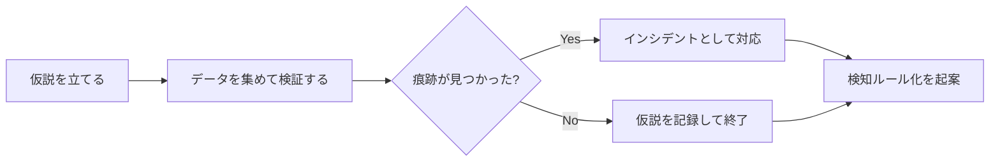

> **文書ID**: SOC-052
> **バージョン**: 0.1.0
> **改訂日**: 2026-11-02

# 脅威ハンティング

検知ルールにかからない攻撃を、仮説を立てて探しに行く。Tier3が月次 `P-21` で実施する。

## 1. 手順

| # | 手順 | 担当 |
|---|---|---|
| 1 | 仮説を立てる。材料は、脅威インテリジェンス、事後レビューの教訓([CSIRT-003](../04-csirt-playbooks/04-03-post-incident-review.md))、業界で報告された攻撃手法など | Tier3 |
| 2 | 仮説を検証するための検索を行い、結果を集める | 調査・分析エージェント(読み取りのみ) |
| 3 | 結果を分析し、攻撃の痕跡かどうかを判断する | Tier3 |
| 4 | 痕跡が見つかった場合は、重大度を判定してインシデントとして対応する([GOV-002](../01-governance/01-02-severity-matrix.md)) | Tier3 |
| 5 | 痕跡の有無にかかわらず、同じ手口を自動で検知できるルールを起案する([SOC-051](03-51-daily-operations.md) 第3章) | Tier3 |

仮説の例:

- 退職者のアカウントが、退職後もクラウドサービスにアクセスしていないか
- 業務時間外に、普段使われないOS標準ツールでの遠隔操作が行われていないか
- 構成会社間で、通常はない通信が発生していないか

## 2. 記録

| 項目 | 内容 |
|---|---|
| 実施日・担当者 | |
| 仮説 | |
| 検証した範囲(期間・対象) | |
| 結果 | 痕跡あり(インシデントID) / 痕跡なし |
| 起案した検知ルール | |
