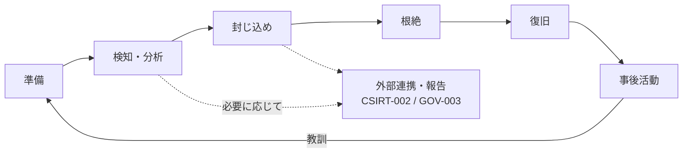

> **文書ID**: CSIRT-001
> **バージョン**: 0.2.0
> **改訂日**: 2026-11-02

# インシデント対応のライフサイクル

重大度がCritical・Highの事案で発動する([GOV-002](../01-governance/01-02-severity-matrix.md))。
役割(インシデントマネージャー、フォレンジックアナリスト、復旧スペシャリスト)は
[GOV-001](../01-governance/01-01-organization-structure.md) 第3章を参照。

## 1. 準備(平時)

- 連絡網、オンコール体制([GOV-005](../01-governance/01-05-operating-hours.md))、ツールへのアクセス権限を維持する。
- 四半期 `P-23` ごとにテーブルトップ演習を行い、本文書と各Runbookを見直す。演習では、夜間の発動と、
  AIのKill-switchの発動も扱う。

## 2. 検知・分析

| 役割 | 作業 |
|---|---|
| インシデントマネージャー | SOCからのエスカレーションを受け、体制を招集する。グループCISOへの社内報告を行う([GOV-002](../01-governance/01-02-severity-matrix.md) 第2章) |
| フォレンジックアナリスト | 影響範囲と侵入経路の初期分析。調査・分析エージェントの結果を使い、証拠の保全を始める |
| 復旧スペシャリスト | 影響を受けたシステムの状態の確認、復旧の選択肢の洗い出し |

外部報告が必要になりそうな場合は、この段階で [GOV-003](../01-governance/01-03-external-reporting-flow.md) の判定を始める(報告期限があるため)。

## 3. 封じ込め

- AIによる措置は [AI-002](../02-agentic-ai/02-02-authority-levels.md) の権限レベルに従う。CSIRT発動中、
  単一の構成会社内のLv3措置はインシデントマネージャーが承認する。
- 封じ込めによって業務が止まる場合は、構成会社責任者に事前に連絡する。

## 4. 根絶

侵害の原因(脆弱性、設定ミス、漏洩した認証情報など)を特定して取り除く。攻撃者が残した
バックドアや追加のアカウントがないかを確認する。

## 5. 復旧

- バックアップからの復元、またはクリーンな状態からの再構築を行う。
- 復旧後は一定期間、対象システムの監視を強化する。
- 隔離・遮断などの措置の解除は、インシデントマネージャーが判断する。

## 6. 事後活動

[CSIRT-003](04-03-post-incident-review.md) に従って事後レビューを行う。
