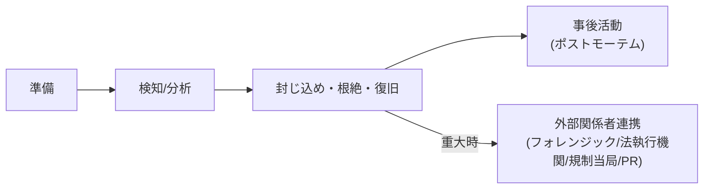

> **文書ID**: CSIRT-001
> **バージョン**: 0.1.0
> **改訂日**: 2026-11-02

# 汎用インシデント対応ライフサイクル

本ライフサイクルは、[組織体制(GOV-001)](../01-governance/01-01-organization-structure.md)で
定義したCSIRT発動体制(インシデントマネージャー/フォレンジックアナリスト/復旧スペシャリスト)の
各役割が、どのフェーズで何を行うかを定義する。

## 1. 準備

- [SOC Runbook(03-soc-runbooks/)](../03-soc-runbooks/)のエスカレーション条件に基づき、
  CSIRT発動体制がいつでも立ち上がれるよう、連絡網・権限・ツールアクセスを事前に整備しておく。
- 四半期ごとに、本ライフサイクル・各Runbookのレビューと模擬演習(テーブルトップ・エクササイズ)を実施する。

## 2. 検知/分析

| 役割 | アクション |
|---|---|
| インシデントマネージャー | SOCからのエスカレーション内容を受理し、対応体制を招集 |
| フォレンジックアナリスト | 影響範囲・侵害経路の初期分析 |
| 復旧スペシャリスト | 影響を受けたシステムの現状確認、復旧オプションの洗い出し |

本フェーズの重大度判定は [GOV-002](../01-governance/01-02-severity-and-escalation.md) に従う。

## 3. 封じ込め・根絶・復旧

- **封じ込め**: [Agentic AIの権限レベル(AI-002)](../02-agentic-ai/02-02-authority-levels.md)の
  Lv2/Lv3操作を中心に、人間の承認を得て実行する。
- **根絶**: 侵害の原因(脆弱性・設定ミス・認証情報漏洩等)を特定し、除去する。
- **復旧**: バックアップからの復元、またはクリーンな状態からの再構築。復旧後は一定期間の監視強化を行う。
- 本フェーズで外部関係者との連携が必要と判断した場合は、
  [外部関係者連携ガイド(CSIRT-002)](04-02-external-coordination.md)に従う。

## 4. 事後活動

インシデント収束後、[事後レビュー(ポストモーテム)フォーマット(CSIRT-003)](04-03-post-incident-review.md)
に従い振り返りを実施し、再発防止アクションを記録する。
