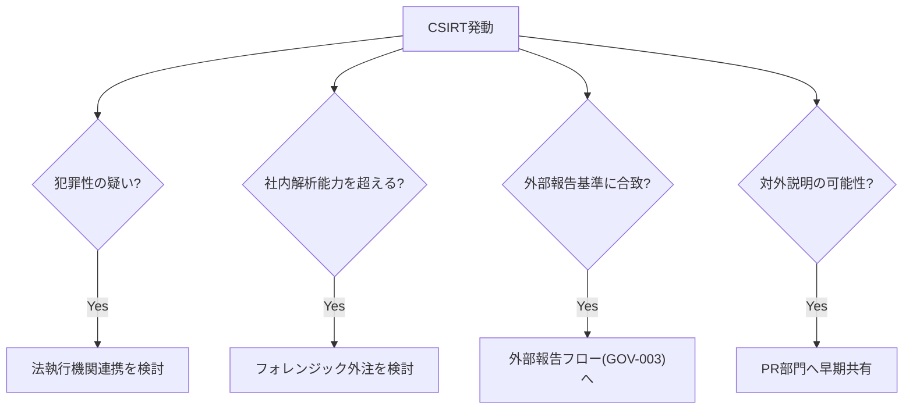

> **文書ID**: CSIRT-002
> **バージョン**: 0.1.0
> **改訂日**: 2026-11-02

# 外部関係者連携ガイド

## 1. フォレンジック外注

- **連携基準**: 社内Tier3での解析が困難な高度な事案(未知の攻撃手法、大規模侵害、法的証拠保全の
  厳密性が求められる事案)
- **判断者**: インシデントマネージャー(CISOへの報告を伴う)
- **留意点**: 証拠保全のchain of custody(管理記録)を外注前から維持すること

## 2. 法執行機関

- **連携基準**: 犯罪性が疑われる事案(ランサムウェア、金銭的詐取、組織的な不正アクセス)
- **判断者**: コーポレートCISO([GOV-001](../01-governance/01-01-organization-structure.md)参照)
- **留意点**: 法執行機関への連携は、社内の法務部門を通じて行う

## 3. 規制当局

- 規制当局への連携は、[外部報告フロー(GOV-003)](../01-governance/01-03-external-reporting-flow.md)の
  判定・承認フローに従う(判定は自動、発信はCISO等の人間承認必須)。

## 4. PR(広報)部門

- **連携タイミング**: 対外的な説明が必要になる可能性がある時点(規制当局報告の判定が出る前、
  または報道・SNSでの言及が確認された時点)で、事実関係の把握状況を共有する。
- **留意点**: 未確定の情報を対外的に発信しないよう、インシデントマネージャーが情報を一元管理する。

## 5. 連携フロー

