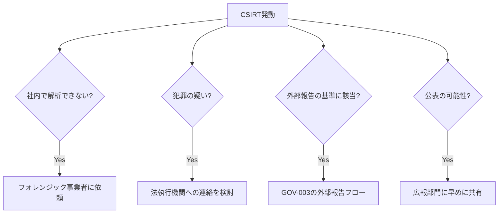

> **文書ID**: CSIRT-002
> **バージョン**: 0.2.0
> **改訂日**: 2026-11-02

# 外部関係者との連携

| 連携先 | 連携する基準 | 判断する人 | 留意点 |
|---|---|---|---|
| フォレンジック事業者 | 社内のTier3では解析が難しい(未知の攻撃手法、大規模な侵害、法的な証拠能力が必要) | インシデントマネージャー(セキュリティ運用責任者に報告) | 依頼の前から証拠の管理記録(誰がいつ扱ったか)を残す |
| 法執行機関 | 犯罪が疑われる(ランサムウェア、金銭の詐取、組織的な不正アクセス) | 構成会社責任者(グループCISOと協議) | 法務部門を通じて連絡する |
| 規制当局・本人・取引先 | [GOV-003](../01-governance/01-03-external-reporting-flow.md) の判定基準に該当 | 構成会社責任者 | GOV-003のフローに従う |
| 情報共有組織 | 他組織への注意喚起が有益な攻撃手法・IoCを確認した | インシデントマネージャー(グループCISOの承認) | 個人情報・顧客情報を含めない |
| 広報部門 | 報道・SNSで言及された、または公表が必要になる可能性がある | インシデントマネージャー | 構成会社とコーポレートの広報で発信内容をそろえる |

> **カスタマイズ:** 連携先の具体的な窓口(警察のサイバー犯罪相談窓口、JPCERT/CCなどの調整機関、
> 業界の情報共有組織、契約しているフォレンジック事業者)と連絡先を、自組織に合わせて記入すること。

## 連携の判断の流れ

インシデントマネージャーは、外部に出す情報を一元的に管理し、確定していない情報を外部に出さない。
