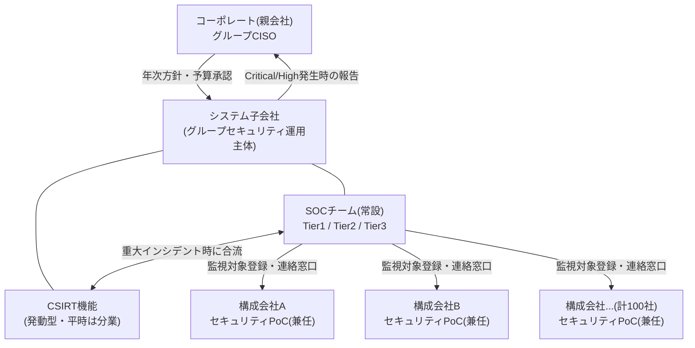
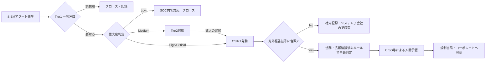

> **文書ID**: SPEC-002
> **バージョン**: 0.1.0
> **改訂日**: 2026-11-01

# 設計書: 組織・ガバナンス設計(サブプロジェクト2)

## 1. 目的・スコープ

本文書は、Agentic AI SOC/CSIRTドキュメント一式のサブプロジェクト2として、SOC・CSIRTの組織体制、
構成会社との関係、重大度分類、エスカレーション基準、RACI、外部報告フローを定める。NIST CSF 2.0の
6機能のうち、主に **Govern** 機能(組織の役割・責任・方針の確立)に対応する。

本文書の内容は、[`01-governance/`](../../../01-governance/) 配下の実文書(組織図・RACI・エスカレーション
基準・外部報告フロー)として展開する前提の設計である。

### スコープ外

- Agentic AIの自律範囲・権限・判断ログの詳細設計 → サブプロジェクト3(`02-agentic-ai/`)
- SOC/CSIRTの具体的な作業手順(Runbook/Playbook) → サブプロジェクト4・5
- インシデント記録フォーマットの項目定義 → サブプロジェクト6

## 2. 組織体制

### 2.1 全体像

- **コーポレート(親会社)**: グループ全体のセキュリティ方針を定め、システム子会社に運用を委任する。
  Critical/Highインシデントの報告を受け、必要に応じて対外対応(規制当局・取引先等)の最終承認を行う。
- **システム子会社**: グループ専任でSOC・CSIRTの運用を担う。100社の構成会社に対するセキュリティ運用の
  一元的な実行主体。
- **構成会社(100社)**: 各社にセキュリティ担当のPoC(Point of Contact、兼任可)を置く。SOCからの
  連絡・資産確認・現場でのログ取得協力・利用者への周知等の一次窓口となる。

### 2.2 SOCの内部階層(Tier構造)

Exabeamが定義するSOCの階層モデルに基づき、以下の3層とする。

| Tier | 役割 | 主な業務 |
|---|---|---|
| Tier 1 | 監視アナリスト | SIEMアラートの一次評価、誤検知のフィルタリング、確認された脅威のエスカレーション |
| Tier 2 | インシデントレスポンダー | Tier1からエスカレートした事案の深掘り分析、初期対応の実施 |
| Tier 3 | SME / 脅威ハンター | 複雑な事案への対応、脅威ハンティング、緩和策・予防策の策定 |

> Agentic AIが各Tierの業務をどの範囲まで代行・支援するか(特にTier1トリアージの自動化)は、
> サブプロジェクト3で詳細に設計する。本文書では組織上の受け皿(Tier構造)のみを定義する。

### 2.3 CSIRTの発動条件と体制

CSIRTはExabeamの定義に倣い、インシデント駆動型の機能とする。平時はシステム子会社内のTier2/3
アナリストが「CSIRT機能担当者」としてSOC業務と兼務し、重大インシデント発生時に以下の体制で合同
チームとして発動する。

| 役割 | 平時の所属 | 発動時の役割 |
|---|---|---|
| インシデントマネージャー | Tier3 SME(兼務) | 対応全体の統括・コーポレートへの報告 |
| フォレンジックアナリスト | Tier2/3(兼務) | 証拠保全・原因分析 |
| 復旧スペシャリスト | Tier2(兼務) | 影響を受けたシステムの復旧 |

**発動条件**: 第3章の重大度分類で Critical または High と判定された事案。

## 3. 重大度分類とエスカレーション基準

### 3.1 重大度分類

| 重大度 | 定義 | 初動対応時間目標 | SOC→CSIRTエスカレーション |
|---|---|---|---|
| Critical | 複数の構成会社・基幹システムに影響、または機密情報の大規模漏洩の疑い | 15分以内 | 必須・即時 |
| High | 単一の構成会社の重要システムに影響、または特定区分の情報漏洩の疑い | 1時間以内 | 必須 |
| Medium | 影響範囲が限定的、拡大の可能性がある事案 | 4時間以内 | Tier3判断で任意 |
| Low | 影響が軽微、または既知の誤検知パターンに近い事案 | 1営業日以内 | 不要(SOC内で対応完了) |

本分類は、Exabeam記事の「SOCからCSIRTへのエスカレーションは、事前定義された重大度・複雑性の
基準を満たした場合に行う」という原則を、具体的な4段階に落とし込んだものである。

### 3.2 エスカレーションフロー

## 4. 外部報告フロー

- **判定**: 法務・広報と事前協議済みのルールベース基準(影響を受けた個人情報件数、業種別の
  規制報告義務、取引先への契約上の通知義務など)により、「外部報告が必要か」をシステム的に自動判定する。
- **発信**: 判定が「必要」となった場合でも、規制当局・コーポレートへの実際の対外発信は、
  CISO等の人間による最終承認を必須とする(Human-in-the-loop)。誤判定による誤通報のリスクを
  人間のレビューで吸収する。
- この判定ロジック・承認フローとAgentic AIの判断権限の関係は、サブプロジェクト3で技術的な
  実装方針として再掲・詳細化する。

## 5. RACI

### 5.1 SOC業務のRACI

| タスク | Tier1 | Tier2/3 | SOCマネージャー | 構成会社PoC |
|---|---|---|---|---|
| アラート監視・一次評価 | R | I | A | I |
| インシデント深掘り分析 | C | R | A | I |
| セキュリティ対策の有効性維持 | I | C | A/R | I |
| 構成会社への状況連絡 | I | R | A | R |

### 5.2 CSIRT発動時のRACI

| タスク | インシデントマネージャー | フォレンジックアナリスト | 復旧スペシャリスト | コーポレートCISO |
|---|---|---|---|---|
| 対応全体の統括 | A/R | I | I | I |
| 証拠保全・原因分析 | C | R | I | I |
| システム復旧 | C | I | R | I |
| コーポレートへの報告 | R | I | I | A |
| 対外発信の最終承認 | I | I | I | A |

(凡例: R=実行責任, A=説明責任, C=相談対象, I=報告先)

## 6. NIST CSF 2.0 (Govern) との対応

| CSF 2.0 サブカテゴリ領域 | 本文書での対応内容 |
|---|---|
| 組織の文脈・役割・責任(GV.OC, GV.RR) | 第2章の組織体制・RACI |
| リスク管理戦略・監督(GV.RM) | 第3章の重大度分類・エスカレーション基準 |
| サプライチェーン・第三者(GV.SC への橋渡し) | 第2章の構成会社PoC体制(100社との関係) |

詳細な成熟度評価は、サブプロジェクト6の評価シートで扱う。
