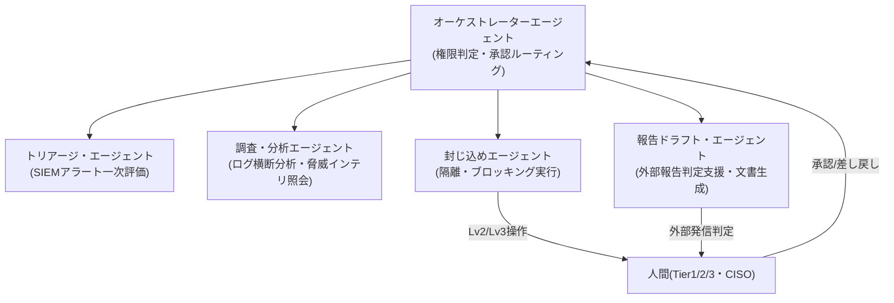
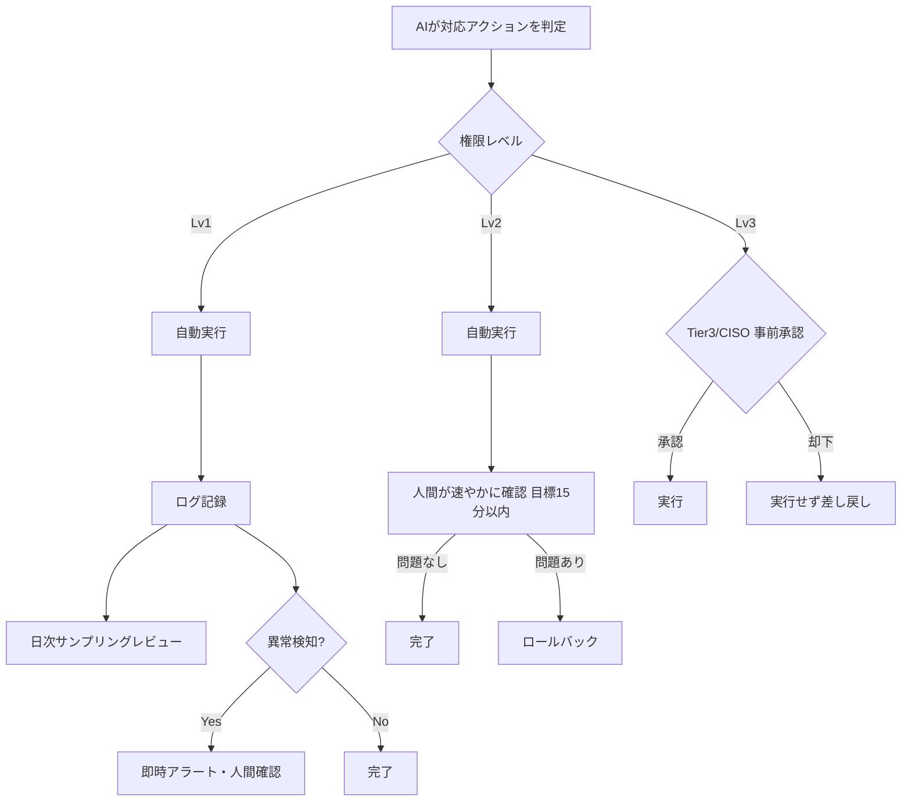

> **文書ID**: SPEC-003
> **バージョン**: 0.1.0
> **改訂日**: 2026-11-02

# 設計書: Agentic AI運用設計(サブプロジェクト3)

## 1. 目的・スコープ

本文書は、SOC/CSIRT運用におけるAgentic AI(自律的に判断・実行するAIエージェント)の権限範囲、
アーキテクチャ、Human-in-the-loopのゲート設計、判断ログ、監査体制、緊急停止の仕組みを定める。
NIST CSF 2.0の **Govern**(AIガバナンス・権限設計)と **Protect**(封じ込めによる防御)に対応する。

本文書の内容は、[`02-agentic-ai/`](../../../02-agentic-ai/) 配下の実文書として展開する。

### スコープ外

- SOC/CSIRTの組織体制そのもの → サブプロジェクト2(文書化済み)
- SOC/CSIRTの具体的な作業手順(Runbook/Playbook)の本文 → サブプロジェクト4・5
  (ただし各手順書内でAIエージェントがどのステップを担当するかは参照する)
- インシデント記録・AI判断ログの具体的なフォーマット(フィールド定義の確定版) → サブプロジェクト6

## 2. アーキテクチャ

オーケストレーターエージェントが全体を制御し、役割ごとに専門化したシングルタスクエージェントの
プールにタスクを振り分ける構成を前提とする。

- 各専門エージェントのツールアクセス権限は最小化する(例: 封じ込めエージェントは隔離・ブロック系
  APIのみ、報告ドラフト・エージェントは文書生成系ツールのみに制限)。
- オーケストレーターが権限レベル判定(第3章)とログ記録(第5章)を一元管理する。

## 3. 権限レベル

AIエージェントが実行する操作を、以下の3段階に分類する。

| レベル | 定義 | 操作例 |
|---|---|---|
| Lv1(自動実行) | 単一対象・可逆的な封じ込め | 単一エンドポイントの隔離、単一IP/ファイルハッシュのブロック、単一アカウントの一時的なセッション無効化 |
| Lv2(事後承認) | 複数対象に及ぶが比較的可逆的 | 複数エンドポイントの一括隔離、部署単位のアカウント一時停止 |
| Lv3(事前承認必須) | 影響が大きい・不可逆性が高い | 本番システムの停止、大量アカウントの無効化、外部通信の全体遮断、対外発信 |

> 実際の運用では、上記の操作例を自組織のアセット分類・システム重要度に応じて具体化すること。

## 4. Human-in-the-loopフロー

異常検知の基準例: 同一対象への短時間での繰り返し実行、AIの判定信頼度が閾値未満、過去に誤判定が
記録されたパターンとの類似。

## 5. 判断ログ(説明可能性)

AIエージェントによるすべての判定・実行は、以下の項目を記録する。

| 項目 | 内容 |
|---|---|
| 判定時刻 | ISO 8601形式 |
| 対象アセット | ホスト名・アカウント・IPなど |
| トリガー | 元となったアラートIDまたは入力データ |
| 実行エージェント | エージェント名・使用モデル |
| 判定根拠 | 自然言語による要約(なぜその対応を選んだか) |
| 権限レベル | Lv1 / Lv2 / Lv3 |
| 実行結果 | 成功/失敗/ロールバックの有無 |
| レビュー結果 | レビュー者・判定(妥当/要修正)・コメント |

記録フォーマットの正式な項目定義(必須/任意、型、保存先)はサブプロジェクト6で確定する。

## 6. 事後レビュー・監査体制

- **日次サンプリングレビュー**: Tier1/2が、Lv1自動実行履歴の一部を日次でサンプリングレビューする。
- **異常検知時の即時アラート**: 判定信頼度が低い、同一対象への繰り返し実行など、あらかじめ定義した
  異常パターンを検知した場合は、サンプリングを待たずに即時アラートし、人間が確認する。
- **四半期レビュー**: SOCマネージャーが、Lv1/Lv2の判定精度・誤検知率・ロールバック件数を集計し、
  権限レベルの区分や異常検知基準を見直す。

## 7. 緊急停止(Kill-switch)

オーケストレーターに、全エージェントの自動実行(Lv1/Lv2含む)を即時停止するスイッチを設ける。
発動権限はSOCマネージャー以上とし、発動後はすべての対応が人間承認必須(Lv3相当)に切り替わる。

## 8. NIST CSF 2.0との対応

| CSF 2.0機能 | 対応内容 |
|---|---|
| Govern | 権限レベル設計(第3章)、Human-in-the-loopフロー(第4章)、監査体制(第6章) |
| Protect | 封じ込めエージェントによる自動防御(第3章Lv1) |

## 9. 本サブプロジェクトのスコープ外(補足)

- 権限レベルの具体的な閾値(何件以上をLv2とするか等)は、サブプロジェクト4・5のRunbook/Playbook
  本文で、SOC/CSIRTの実際の作業ステップに即して具体化する。
