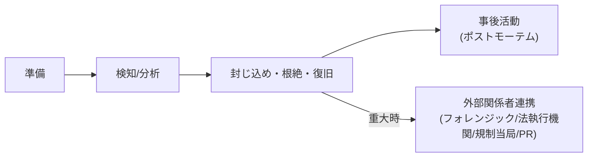

> **文書ID**: SPEC-005
> **バージョン**: 0.1.0
> **改訂日**: 2026-11-02

# 設計書: CSIRTプレイブック(サブプロジェクト5)

## 1. 目的・スコープ

本文書は、重大インシデント発生時にCSIRTが従うプレイブックの構成を定義する。NIST CSF 2.0の
**Respond** / **Recover** 機能に対応する。実文書は [`04-csirt-playbooks/`](../../../04-csirt-playbooks/)
配下に展開する。

### スコープ外

- SOCによる検知・一次トリアージ → サブプロジェクト4(文書化済み)
- 記録フォーマットの正式項目定義 → サブプロジェクト6

## 2. 文書構成

| # | 文書 | 内容 |
|---|---|---|
| 1 | 汎用インシデント対応ライフサイクル | 準備→検知/分析→封じ込め・根絶・復旧→事後活動のNIST準拠ライフサイクル |
| 2 | 外部関係者連携ガイド | フォレンジック外注・法執行機関・規制当局・PRとの連携タイミングと判断基準 |
| 3 | 事後レビュー(ポストモーテム)フォーマット | 実施タイミング・参加者・記載項目 |
| 4 | 補足: ランサムウェア対応プレイブック | [SOC-004](../../../03-soc-runbooks/03-04-ransomware-precursor.md)からのエスカレーション後のCSIRT側対応 |
| 5 | 補足: データ漏洩対応プレイブック | [SOC-002](../../../03-soc-runbooks/03-02-phishing.md)/[SOC-007](../../../03-soc-runbooks/03-07-cloud-misconfiguration.md)等からのエスカレーションを想定 |

## 3. 各文書の要点

### 3.1 汎用インシデント対応ライフサイクル

- [組織体制(GOV-001)](../../../01-governance/01-01-organization-structure.md)で定義したCSIRT発動体制
  (インシデントマネージャー/フォレンジックアナリスト/復旧スペシャリスト)の各役割が、ライフサイクルの
  どのフェーズで何を行うかを定義する。

### 3.2 外部関係者連携ガイド

- フォレンジック外注が必要となる基準(社内のTier3で解析が困難な高度な事案)
- 法執行機関への連携基準(犯罪性が疑われる事案)
- 規制当局への連携は [外部報告フロー(GOV-003)](../../../01-governance/01-03-external-reporting-flow.md) の
  判定・承認フローに従う
- PR部門との連携タイミング(対外的な説明が必要になる前)

### 3.3 事後レビュー(ポストモーテム)フォーマット

- 実施タイミング: インシデント収束後、原則1週間以内
- 参加者: インシデントマネージャー、関係Tierアナリスト、必要に応じてCISO
- 記載項目: タイムライン、根本原因、良かった点、改善点、再発防止アクション(担当・期限付き)

### 3.4 補足プレイブック(ランサムウェア・データ漏洩)

- 汎用ライフサイクルの各フェーズに、シナリオ固有の判断ポイント(バックアップからの復旧可否、
  身代金交渉方針の原則、漏洩範囲の確定方法等)を補足する。

## 4. NIST CSF 2.0との対応

| CSF 2.0機能 | 対応内容 |
|---|---|
| Respond | 汎用ライフサイクルの「検知/分析」「封じ込め・根絶」フェーズ、外部関係者連携 |
| Recover | 汎用ライフサイクルの「復旧」フェーズ、事後レビュー |
