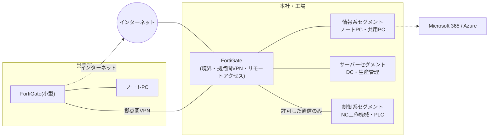

> **文書ID**: EXA-001
> **バージョン**: 0.1.0
> **改訂日**: 2026-11-08

# 想定組織(A社)のプロファイル

この事例のすべての文書は、本文書の値だけを前提にする。組織に関する値を他の文書に直接書かず、本文書を参照する。

> **カスタマイズ:** この事例を自組織の検討に使う場合も、実在のホスト名・IPアドレス・アカウント名・ネットワーク構成は
> 書き込まないこと。事例の文書は公開・共有されることを前提にする。

## 1. 事業と規模

| 項目 | 内容 |
|---|---|
| 社名 | A社(架空) |
| 業種 | 自動車部品の金属加工(完成車メーカーの二次サプライヤ) |
| 従業員 | 160名(本社管理部門 35名、工場 115名、営業所 10名) `P-01` |
| 法人の数 | 1社(子会社なし) `P-02` |
| 拠点 | 本社・工場(同じ敷地)、営業所1か所 |
| 勤務形態 | 工場は2交替制(6:00〜22:00)、本社・営業所は平日日中。管理部門の一部は在宅勤務あり |

## 2. 情報システムの体制

| 役割 | 人数 | 所属・兼務 |
|---|---|---|
| 情報セキュリティ責任者 | 1名 | 管理部長が兼務。経営会議のメンバー |
| 情報システム担当 | 2名 | 管理部。1名は主担当としてセキュリティ運用を担い、もう1名はヘルプデスク・端末管理が主 |
| 工場の設備担当 | 3名 | 製造部。制御系(OT)の機器の保守を担う。セキュリティ運用の要員ではない |

セキュリティ専任の要員はいない。24時間の監視は外部のMDR事業者に委託する([EXA-003](03-organization-and-operations.md))。

## 3. 情報資産

| 区分 | 内容 | 重要度 |
|---|---|---|
| 業務基盤 | Microsoft 365(メール、Teams、SharePoint、OneDrive)。ファイルサーバーはSharePointに移行済み | 高 |
| 認証基盤 | オンプレミスのActive Directory(ドメインコントローラ1台)を、Entra ID と同期 | 高(保護資産) |
| 生産管理システム | オンプレミスのWindows Server 1台(アプリケーションとデータベース)。受注・生産計画・出荷を管理 | 高(保護資産) |
| 図面・技術資料 | 取引先から受領した図面を含む。SharePointの専用サイトに保存し、秘密度ラベルで保護 | 高(取引先との契約で管理を求められる) |
| 端末 | Windows 11のノートPC 95台(管理部門・営業)、工場の共用PC 25台。すべてIntuneで管理 | 中 |
| 制御系(OT) | NC工作機械、PLC、設備監視用のPC。工場内の独立したセグメントに置く | 高(保護資産) |
| 個人情報 | 従業員の人事・給与情報(約200名分、退職者を含む)。顧客は法人のため、顧客の個人情報は取引先の担当者の連絡先のみ | 中 |

## 4. ネットワーク

- 制御系セグメントと情報系セグメントの間は、FortiGateで許可した通信(生産管理システムとの連携、設備担当の保守端末)だけを通す。
- 在宅勤務と出張時のリモートアクセスは、FortiGateのIPsec VPNを使う。認証はEntra IDのSAML連携で多要素認証を求める([EXA-002](02-product-configuration.md))。
- 工場の設備ベンダーによるリモート保守は、設備担当が都度許可する方式とする(常時接続の回線は置かない)。

## 5. 取引先からの要請と、対策の水準

- 完成車メーカー・一次サプライヤから、業界団体のサイバーセキュリティガイドラインに基づく自己評価の提出を毎年求められている。
- 取引先との契約で、図面・技術資料の漏えいや、生産に影響するインシデントの通知を求められている([EXA-021](21-external-reporting.md))。
- サイバー保険に加入しており、保険会社が提携するインシデント対応事業者を事故時に利用できる。

> **カスタマイズ:** 取引先の要請の内容(ガイドラインの版、自己評価の水準、通知の期限)は契約書で確認し、
> [EXA-021](21-external-reporting.md) に反映すること。

## 6. 導入済みの前提

汎用の一式のREADME「前提」(Agentic AIを用いたSOC運用基盤と、ログをSIEMへ連携する仕組みを導入済み)に対して、この事例では次を前提とする。

- Microsoft 365 Business Premium を全従業員分(160ライセンス)契約している。
- Microsoft Sentinel のワークスペースを、Azureの東日本リージョンに作成済みである。
- Agentic AI基盤は、情報システム担当が設計し、構築・保守は外部の開発事業者に委託する([EXA-005](05-agent-implementation.md))。
