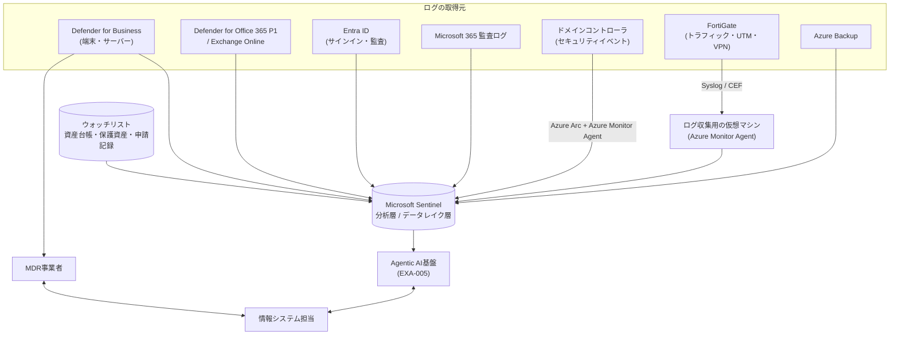

> **文書ID**: EXA-002
> **バージョン**: 0.1.0
> **改訂日**: 2026-11-08

# 製品構成とログ連携

## 1. 製品の選定方針

- **ライセンスをまとめる**: Microsoft 365 Business Premium(300ユーザーまで)に含まれる機能を最大限に使い、
  個別に契約する製品を減らす。導入・運用の窓口と管理画面の数を減らすことを優先する。
- **ログを1か所に集める**: すべてのログをMicrosoft Sentinelに集める。証拠収集サービスが参照する取得元を1つにし、
  調査範囲をコードで強制しやすくする([AI-006](../../02-agentic-ai/02-06-evidence-grounded-investigation.md) 原則3)。
- **人が足りない部分は委託する**: 24時間の監視と、EDRのアラートの一次対応はMDR事業者に委託する。

## 2. 汎用の一式のプレースホルダーとの対応

| 汎用の一式の記載 | この事例の製品 | 備考 |
|---|---|---|
| SIEM | Microsoft Sentinel(Defenderポータルで利用) | Azureポータルでの提供は2027年3月末に終了予定のため、最初からDefenderポータルで運用する |
| EDR・アンチウイルス | Microsoft Defender for Business(Business Premiumに含まれる) | サーバーは Defender for Business servers(追加ライセンス)を2台分 |
| IDプロバイダ・認証ログ | Microsoft Entra ID P1(Business Premiumに含まれる)、オンプレミスのActive Directory | Entra ID P2(リスクベースの条件付きアクセス)は含まれない |
| メールゲートウェイ | Exchange Online Protection、Microsoft Defender for Office 365 Plan 1(Business Premiumに含まれる) | Plan 2の機能(脅威エクスプローラー、自動調査)は含まれない |
| 端末管理 | Microsoft Intune Plan 1(Business Premiumに含まれる) | |
| DLP・情報保護 | Microsoft Purview Information Protection(秘密度ラベル)、DLP(Business Premiumに含まれる範囲) | |
| ファイアウォール・プロキシ・DNS | FortiGate(本社・工場、営業所)のファイアウォール・Webフィルタ・DNSフィルタ | 独立したプロキシは置かない |
| VPN・リモートアクセス | FortiGateのIPsec VPN(FortiClient)、Entra IDとのSAML連携による多要素認証 | FortiOS 7.6.3以降はSSL-VPNのトンネルモードが使えないため、IPsec VPNで構成する |
| クラウドの構成情報・監査ログ | Azure Activity、Microsoft 365の監査ログ | IaaS上の業務システムはないため、[SOC-007](../../03-soc-runbooks/03-07-cloud-misconfiguration.md) の対象はSharePoint・OneDriveの外部共有とAzureの基盤自体 |
| バックアップ管理 | Azure Backup(生産管理システム、ドメインコントローラ)、Microsoft 365 のバックアップ機能 | バックアップのコンテナーは変更不可(immutable)の設定にする |
| 資産台帳・保護資産リスト | Intuneの端末一覧とEntra IDのグループを元に、SharePointリストで管理 | Sentinelのウォッチリストに同期する([EXA-006](06-actions-and-protected-assets.md)) |
| 申請記録(出張・在宅勤務・変更管理) | SharePointリスト(Power Automateの申請フロー) | Sentinelのウォッチリストに同期する |
| 脅威インテリジェンス | Sentinelの脅威インテリジェンス機能(Microsoftの提供分)、JPCERT/CC・IPAの注意喚起 | 外部の有償フィードは契約しない |
| Agentic AI SOC基盤 | Azure上に構築する([EXA-005](05-agent-implementation.md)) | |
| MDR | 国内のMDR事業者(Defender for Business の監視に対応した事業者) | 製品名は特定しない。契約の要件を [EXA-003](03-organization-and-operations.md) 第4章に定める |

## 3. 全体構成

## 4. ログ連携と保存

| 取得元 | 連携方法 | 主なテーブル | 保存の層 |
|---|---|---|---|
| Defender for Business(アラート・インシデント) | Defender XDRコネクタ | `SecurityAlert`、`SecurityIncident` | 分析層 |
| Defender for Business(端末のイベント) | Defender XDRコネクタ(またはストリーミングAPI) | `DeviceProcessEvents`、`DeviceNetworkEvents`、`DeviceFileEvents`、`DeviceLogonEvents`、`DeviceEvents`、`DeviceInfo` | 分析層 |
| Defender for Office 365 P1 | Defender XDRコネクタ | `EmailEvents`、`EmailUrlInfo`、`EmailAttachmentInfo`、`UrlClickEvents` | 分析層 |
| Entra ID | Entra IDの診断設定 | `SigninLogs`、`AADNonInteractiveUserSignInLogs`、`AuditLogs` | 分析層 |
| Microsoft 365 監査ログ | Microsoft 365コネクタ | `OfficeActivity` | 分析層 |
| ドメインコントローラ | Azure Arc + Azure Monitor Agent(Windowsセキュリティイベント) | `SecurityEvent` | 分析層 |
| FortiGate | Syslog(CEF)をログ収集用の仮想マシンで受け、Azure Monitor Agentで送る | `CommonSecurityLog` | UTM・VPN・拒否のログは分析層、許可したトラフィックのログはデータレイク層 |
| Azure Backup | 診断設定 | `AddonAzureBackupJobs` など | 分析層 |
| Azure Activity | Azure Activityコネクタ | `AzureActivity` | 分析層 |
| Agentic AI基盤 | 診断設定とアプリケーションのログ | カスタムテーブル(判断ログ、エージェントの操作ログ) | 分析層([EXA-005](05-agent-implementation.md) 第6章) |

- Microsoftのセキュリティ製品のアラート(`SecurityAlert`)と、Microsoft 365の監査ログの一部は、Sentinelの無料の取り込み対象である。
  端末のイベント(`Device*`)とEntra IDのサインインログは課金の対象になる。
- 費用の大半は、端末のイベントとFortiGateのトラフィックログが占める。導入前に2週間の試験取り込みで1日あたりの量を測り、
  分析層とデータレイク層への振り分けを決める。
- 保存期間は [EXA-004](04-parameters.md) の `P-19`、`P-20` に従う。

> **要確認:** Defender for Business で取り込める端末のイベントのテーブルと、Defender for Office 365 Plan 1 で
> 取り込めるメールのテーブルの範囲は、導入時にMicrosoftの最新の資料と試験取り込みで確認すること。取り込めない
> テーブルがある場合は、[EXA-007](07-evidence-sources.md) の該当する証拠項目を「未確認(ログソース未接続)」として扱う。

## 5. 製品情報の確認日と参照先

この文書の製品情報は 2026-11-08 に、次の公開情報で確認した。製品の設計根拠ではなく、事例の前提条件の確認に使う。
設計根拠は汎用の一式と同じくNISTの文書とする([OV-005](../../00-overview/00-05-references.md))。

| 事項 | 参照先 |
|---|---|
| Business Premiumに含まれる機能、300ユーザーの上限 | Microsoft 365 Business Premium の製品ページ、Microsoft Learn(Business Premiumのセキュリティの概要) |
| Defender for Business のストリーミングAPI(端末のイベントのSentinelへの送信) | Microsoft Learn「Use the streaming API with Microsoft Defender for Business」 |
| Defender for Business の自動調査と修復(自動化のレベルが固定) | Microsoft Learn(Defender for Business の概要) |
| Defender for Business servers の提供条件 | Microsoft の製品ページ |
| Sentinelの無料の取り込み対象 | Microsoft Sentinel の価格ページ |
| SentinelのAzureポータルでの提供終了(2027年3月31日) | Microsoft Learn(Unified security operations の新機能) |
| FortiOS 7.6.3でのSSL-VPNトンネルモードの廃止 | Fortinet のリリースノート、Fortinet Community の技術情報 |
