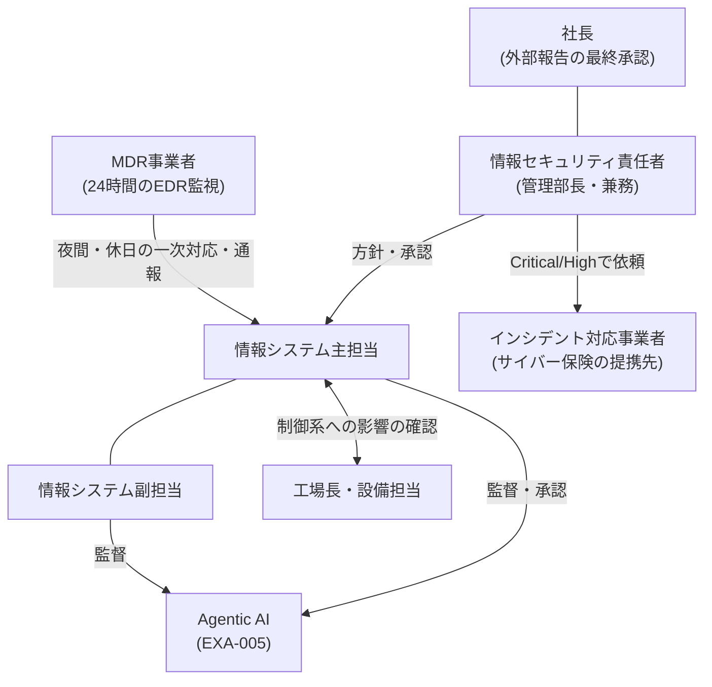

> **文書ID**: EXA-003
> **バージョン**: 0.1.0
> **改訂日**: 2026-11-08

# 体制・運用時間・RACIの置き換え

汎用の一式の役割([GOV-001](../../01-governance/01-01-organization-structure.md))を、A社の要員と外部の事業者に割り当てる。
役割の定義と、AIが説明責任(A)を持たないという原則([GOV-004](../../01-governance/01-04-raci.md))は変えない。

## 1. 全体像

## 2. 役割の割り当て

| 汎用の一式の役割 | A社での担当 | 補足 |
|---|---|---|
| グループCISO | 情報セキュリティ責任者 | 社内報告の受け手。CSIRT発動時はインシデントマネージャーを兼ねる |
| 構成会社責任者 | 社長 | 外部報告の最終承認者([EXA-021](21-external-reporting.md)) |
| セキュリティ運用責任者 | 情報セキュリティ責任者 | 単一の法人のため、グループCISOと同じ人が担う |
| 構成会社PoC | 情報システム副担当(工場は設備担当) | 資産・保護資産の登録、現場での調査協力 |
| SOCマネージャー | 情報システム主担当 | 日常運用の責任者 |
| Tier1(AI出力の監督者) | 情報システム主担当・副担当 | 有人時間帯のケースの確認、Lv2の事後確認、日次のレビュー |
| Tier2(インシデントレスポンダー) | 情報システム主担当(夜間・休日のEDRの範囲はMDR事業者) | 判定保留のケースの判断、Lv3措置の起案 |
| Tier3(SME・脅威ハンター) | MDR事業者のアナリスト、インシデント対応事業者 | 社内にはいない。脅威ハンティングは四半期ごとにMDR事業者と共同で行う |
| インシデントマネージャー | 情報セキュリティ責任者(実務は主担当が補佐) | |
| フォレンジックアナリスト | インシデント対応事業者 | 証拠の保全は、依頼までの間は主担当が行う |
| 復旧スペシャリスト | 情報システム副担当、生産管理システムの保守事業者 | |

### 要員が少ないことによる制約と対策

| 制約 | 対策 |
|---|---|
| Lv3措置の起案者と承認者を別の人にできないことがある | 原則は別の人(起案は主担当、承認は副担当または情報セキュリティ責任者)とする。夜間・休日に1人しか応答できない場合は同じ人が起案・承認してよいが、翌営業日にもう1人が判断ログを確認する |
| 2人とも不在になる期間がある(休暇・出張) | 不在の期間は、MDR事業者との契約で日中の一次対応も委託する([第4章](#4-mdr事業者との契約の要件))。不在の予定を事前にMDR事業者へ通知する |
| 脅威ハンティング・検知ルールの改善を社内で行う余力がない | MDR事業者の定期報告とあわせて四半期ごとに行う(`P-21`、`P-22`) |

## 3. 運用時間とオンコール

[GOV-005](../../01-governance/01-05-operating-hours.md) の体制を次のとおり置き換える。

| 項目 | 有人時間帯(平日 8:30〜17:30 `P-03`) | 夜間・休日 |
|---|---|---|
| 監視・一次評価 | AIがケースを作成し、主担当・副担当が確認 | AIがケースを作成。EDRのアラートはMDR事業者も監視 |
| Lv1措置 | 自動実行 | 自動実行 |
| Lv2措置 | 自動実行後、主担当・副担当が30分以内 `P-11` に確認 | MDR事業者の契約範囲の措置(端末の隔離など)は、自動実行後にMDR事業者が30分以内 `P-08` に確認する。契約範囲外の措置(アカウントの無効化など)は、夜間・休日はLv3として扱う([EXA-031](31-design-decisions.md) D-03) |
| Lv3措置 | 承認者([EXA-006](06-actions-and-protected-assets.md) 第4章)が承認 | 社内のオンコールを呼び出して承認を得る |
| Critical / High | CSIRT発動 | MDR事業者が社内のオンコールを呼び出し、CSIRT発動 |

### オンコールの順位

| 順位 | 担当 | 呼び出す条件 | 応答時間目標 |
|---|---|---|---|
| 一次 | MDR事業者 | EDRのアラート、AIのLv2措置(契約範囲内)、AIの異常検知アラート | 30分以内 `P-08` |
| 二次 | 情報システム主担当・副担当(週替わりの当番) | Lv3措置の承認、High以上の判定、MDR事業者からの通報 | 60分以内 `PA-01` |
| 三次 | 情報セキュリティ責任者 | 二次が応答しない、CSIRT発動、工場の停止を伴う判断 | 60分以内 `PA-01` |

- 工場の稼働時間(6:00〜22:00)のうち有人時間帯の外で、制御系への影響が疑われる場合は、三次と同時に工場長を呼び出す。
- 当番は週替わりとし、当番でない日は呼び出しを受けない。休暇の予定を当番表に反映する。

> **カスタマイズ:** 夜間・休日の呼び出しは就業規則上の扱い(待機手当など)を人事部門と決めておくこと。

## 4. MDR事業者との契約の要件

| 項目 | 要件 |
|---|---|
| 監視の範囲 | Defender for Business のアラート(端末・サーバー)。24時間365日 |
| 実行してよい措置 | 保護資産でない端末の隔離、ファイルの検疫、プロセスの停止 |
| 事前の承認を要する措置 | 保護資産([EXA-006](06-actions-and-protected-assets.md) 第3章)への措置はすべて、電話で二次以降の承認を得てから実行する |
| 通報 | High以上と判断した事案は、30分以内に電話で一次通報する。それ以外は日次の報告 |
| 措置の記録 | MDR事業者が実行した措置は、Defenderの操作履歴に残る方法で行う(Sentinelに取り込み、判断ログと突き合わせるため) |
| アカウント | MDR事業者の要員ごとに個別のアカウントを発行する(共用しない)。多要素認証を必須とし、権限はDefenderの対応に必要な範囲に限る。四半期ごとに棚卸しする |
| データの扱い | 監視で得たデータの保存場所・保存期間・再委託の有無を契約で定める |
| 報告 | 月次の報告(対応件数、措置、検知ルールの改善提案)と、四半期ごとの脅威ハンティングの共同実施 |

MDR事業者は、A社の判断ログを変更できない。MDR事業者が実行した措置は「外部の事業者による措置」として判断ログに記録し、
AIの措置と同じく継続か解除かを人間が判断する(`P-12`)。

## 5. RACIの置き換え

[GOV-004](../../01-governance/01-04-raci.md) の列を次のとおり読み替える。タスクとR・Aの配置は変えない。

| GOV-004の列 | A社での担当 |
|---|---|
| Tier1 | 情報システム主担当・副担当 |
| Tier2 | 情報システム主担当(夜間・休日のEDRの範囲はMDR事業者) |
| Tier3 | MDR事業者のアナリスト。ただしLv3措置の承認(R)は社内の承認者が担う |
| SOCマネージャー | 情報システム主担当 |
| セキュリティ運用責任者、グループCISO | 情報セキュリティ責任者 |
| 構成会社責任者 | 社長 |
| 構成会社PoC | 情報システム副担当(工場は設備担当) |

読み替えの結果、次の2点が汎用の一式と異なる。

| タスク | 汎用の一式 | A社 | 理由 |
|---|---|---|---|
| Lv3措置の承認(単一の構成会社内) | R(承認)= Tier3 | R(承認)= 副担当または情報セキュリティ責任者 | 外部の事業者に承認の責任を持たせない |
| Kill-switchの発動 | A/R = SOCマネージャー | R = 主担当・副担当・情報セキュリティ責任者の誰でも可、A = 情報セキュリティ責任者 | 自動実行を止める方向の操作であり、要員が少ないため発動できる人を広げる([EXA-031](31-design-decisions.md) D-04) |
