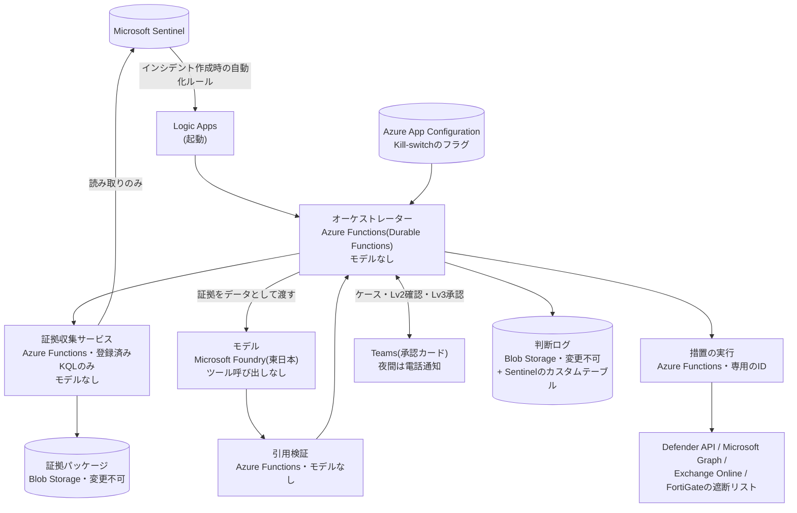

> **文書ID**: EXA-005
> **バージョン**: 0.1.0
> **改訂日**: 2026-11-08

# Agentic AI基盤の実装

[AI-001](../../02-agentic-ai/02-01-architecture.md) の構成要素を、Azureのサービスで実装する。AI-001の3つの原則
((1) 読み取り系と書き込み系のエージェントを分ける、(2) 証拠の収集はコードで行い調査範囲をコードで強制する、
(3) 所見の引用をコードで検証してから人間に渡す)は維持する。

## 1. 全体構成



## 2. 構成要素とAzureのサービス

| AI-001の構成要素 | 実装 | モデル | 補足 |
|---|---|---|---|
| オーケストレーター | Azure Functions(Durable Functions) | なし | 権限レベルの判定([AI-002](../../02-agentic-ai/02-02-authority-levels.md))をコードで行う |
| 証拠収集サービス | Azure Functions | なし | 登録済みのKQLクエリだけを実行する(第4章) |
| 引用検証 | Azure Functions | なし | [AI-006](../../02-agentic-ai/02-06-evidence-grounded-investigation.md) 第7章の検証をコードで行う |
| トリアージ・エージェント | Microsoft Foundry の軽量なモデル | あり | 入力はアラートと除外条件だけ |
| 調査・分析エージェント群 | Microsoft Foundry の高性能なモデル | あり | テレメトリ分析、資産・ユーザーコンテキスト、脅威インテリジェンス、統合の4つ(グループ横断は置かない) |
| 封じ込めエージェント | Azure Functions(措置の実行) | なし | オーケストレーターが判定した措置だけを、決められたAPIで実行する。モデルは措置を選ばない |
| 報告ドラフト・エージェント | Microsoft Foundry の高性能なモデル | あり | 送信の機能を持たない。下書きをSharePointの制限されたサイトに保存する |

汎用の一式の「封じ込めエージェント」は、この事例ではモデルを使わない実行関数とする。措置の候補は統合エージェントが
Runbookの手順から選び、実行するかどうかはオーケストレーターが規則で決める。実行関数は、決められた措置を決められたAPIで
実行するだけで、判断をしない([EXA-031](31-design-decisions.md) D-01)。

## 3. 識別と権限

構成要素ごとに別のマネージドIDを割り当てる([AI-001](../../02-agentic-ai/02-01-architecture.md) 第3章)。

| ID | 使う構成要素 | 付与する権限 | 付与しない権限 |
|---|---|---|---|
| `mi-orchestrator` | オーケストレーター | モデルの呼び出し、証拠パッケージ・判断ログの作成(上書き・削除はできない)、App Configurationの読み取り、Teamsへの通知 | Sentinelのクエリ、措置のAPI |
| `mi-evidence` | 証拠収集サービス | SentinelのワークスペースのLog Analytics閲覧者、証拠パッケージの作成 | 書き込み系のAPI、モデルの呼び出し |
| `mi-validator` | 引用検証 | 証拠パッケージの読み取り | それ以外のすべて |
| `mi-containment` | 措置の実行 | [EXA-006](06-actions-and-protected-assets.md) 第2章の措置に必要な権限だけ(端末の隔離、IoCの登録、指定した管理単位のユーザーのセッション無効化など) | 管理者ロール全般、保護資産への操作、削除系の操作 |

- モデルにはツール呼び出し(関数呼び出し)の機能を与えない。モデルは、オーケストレーターから渡された入力に対して
  構造化された出力(JSON)を返すだけで、SentinelやAPIに直接アクセスできない。
- Sentinelのデータを自然言語で検索させる機能(MCPサーバー、Security Copilotなど)は、エージェントには使わせない。
  モデルに検索させると調査範囲を逸脱するため([AI-006](../../02-agentic-ai/02-06-evidence-grounded-investigation.md) 原則2)。
  人間が脅威ハンティングで使うことは妨げない。
- マネージドIDのサインインログ(`AADManagedIdentitySignInLogs`)をSentinelに取り込み、想定外の利用を検知する(第7章)。

## 4. 証拠収集の実装

- 証拠の取得は、各Runbook第7章の証拠項目ごとに登録したKQLクエリ(クエリID付き)で行う。対応表は [EXA-007](07-evidence-sources.md)。
- クエリはGitリポジトリで管理し、変更は変更管理([AI-005](../../02-agentic-ai/02-05-ai-specific-threats.md))に従う。
- クエリのパラメータ(対象のアカウント・端末・期間)は、アラートのエンティティからコードが設定する。モデルの出力をパラメータに使わない。
- パラメータの値は、型ごとの形式(UPN、デバイスID、IPアドレス、日時)をコードで検証してからクエリに埋め込む。
  形式に合わない値はクエリに使わず、その証拠項目を「未確認」とする。

クエリの例(SOC-001の「対象アカウントのログイン成功・失敗の履歴」):

```kql
// EQ-SOC001-01 対象アカウントのログイン履歴
// target_upn, start_time, end_time は証拠収集サービスが設定する
SigninLogs
| where TimeGenerated between (start_time .. end_time)
| where UserPrincipalName =~ target_upn
| project TimeGenerated, UserPrincipalName, IPAddress,
          Country = tostring(LocationDetails.countryOrRegion),
          AppDisplayName, ClientAppUsed, DeviceDetail,
          AuthenticationRequirement, ResultType, CorrelationId
```

### 「未確認」の判定

[AI-006](../../02-agentic-ai/02-06-evidence-grounded-investigation.md) 第4章の状態を、証拠収集サービスが次の規則で付ける。

| 状況 | 状態 |
|---|---|
| クエリが成功し、1件以上の結果がある | 確認済み・該当あり |
| クエリが成功して結果が0件で、取得元のテーブルが直近 `P-25` の間に受信している | 確認済み・該当なし |
| 取得元のテーブルが直近 `P-25` の間に受信していない | 未確認(ログの途絶) |
| 取得元のコネクタが未設定、またはテーブルが存在しない | 未確認(ログソース未接続) |
| 収集期間が分析層の保存期間(`P-20`)を超える | 未確認(保存期間外)。データレイク層の検索を人間が指示した場合は、版を追加して登録する |
| クエリが権限エラー・タイムアウトで失敗した | 未確認(参照権限なし)。タイムアウトは理由に併記する |
| 端末にDefenderが導入されていない(`DeviceInfo` に記録がない) | その端末の端末のイベントは未確認(ログソース未接続) |

## 5. モデルの利用

| 項目 | 内容 |
|---|---|
| 提供先 | Microsoft Foundry。デプロイは日本国内のリージョン `PA-03` |
| モデルのバージョン | デプロイ時にバージョンを固定し、自動更新しない。更新は変更管理に従う([AI-005](../../02-agentic-ai/02-05-ai-specific-threats.md)) |
| 入力 | 指示(システムプロンプト)と、証拠パッケージの該当部分(JSON)を分けて渡す。証拠は「データ」であり指示ではないことを指示に明記する |
| 出力 | JSONスキーマで形式を固定する。判定区分と推奨は [AI-006](../../02-agentic-ai/02-06-evidence-grounded-investigation.md) 第6章の語彙の列挙型とする |
| 送るデータの範囲 | 証拠パッケージの項目のうち、所見に必要な項目(アカウント名、端末名、IPアドレス、URL、ハッシュ、時刻など)。メールの本文、添付ファイルの中身は送らない |
| 内部不正のケース | [SOC-005](../../03-soc-runbooks/03-05-insider-threat.md) のケースでは、アカウント名を仮名に置き換えてから送る。仮名と実名の対応は証拠パッケージにだけ保存する |

> **要確認:** 入力データの保存・学習への利用の条件、不正利用の監視のために入力が一時的に保存されるかどうかと、
> その保存場所を、契約と最新の資料で確認すること。条件が要件に合わない場合は、送るデータの範囲を狭める。

## 6. 判断ログと証拠パッケージの保存

| 項目 | 実装 |
|---|---|
| 保存先 | Blob Storage。時間ベースの保持ポリシー(5年 `P-19`)をロックした変更不可のコンテナー |
| 書き込み | `mi-orchestrator` と `mi-evidence` は新しいBLOBの作成だけを行う。変更不可の設定により、作成した後は誰も変更・削除できない |
| 検索 | 同じ内容をSentinelのカスタムテーブル(判断ログ: `AIDecisionLog_CL`、エージェントの操作: `AIAgentOps_CL`)にも送り、インシデントから参照できるようにする([AI-003](../../02-agentic-ai/02-03-decision-logging.md)) |
| 参照できる人 | 情報システム主担当・副担当、情報セキュリティ責任者、内部監査の担当。MDR事業者は参照しない |
| 内部不正のケース | 別のコンテナーに保存し、参照できる人を情報セキュリティ責任者と、指名された担当者に限る |

記録項目は [REC-002](../../05-records-kpi/05-02-ai-decision-log-format.md) に従う。MDR事業者とDefender for Businessの自動修復による措置は、
Defenderの操作履歴から取り込み、「外部の事業者による措置」「製品の自動修復」として同じテーブルに記録する([EXA-006](06-actions-and-protected-assets.md) 第5章)。

## 7. 監査と緊急停止

### 異常検知

[AI-004](../../02-agentic-ai/02-04-audit-and-kill-switch.md) の異常検知の条件を、Sentinelの分析ルールとして実装する。検知したら、時間帯に応じた担当([EXA-003](03-organization-and-operations.md) 第3章)を呼び出す。

| 条件 | 実装の例 |
|---|---|
| 同じ対象への措置の繰り返し | `AIDecisionLog_CL` で、同じ対象への措置が1時間に2件以上 |
| 措置の件数の急増 | `AIDecisionLog_CL` で、1時間の措置の件数が過去30日の同じ時間帯の最大値を超える |
| 調査範囲外の引用 | 引用検証の結果に「範囲の不一致」がある |
| 判定保留・不合格の急増 | 1日の判定保留率・不合格率が過去30日の平均の2倍を超える |
| エージェントのIDの想定外の利用 | マネージドIDのサインインが、Azure Functions以外の送信元から行われた |

> **カスタマイズ:** 閾値は導入後3か月の判断ログを基に見直すこと。

### Kill-switch

| 段階 | 操作 | 使う場面 |
|---|---|---|
| 通常の発動 | App Configurationのフラグを「無効」にする(Teamsの操作カードから実行できる)。オーケストレーターは措置の前に毎回フラグを確認し、無効ならすべての措置をLv3として扱う | 誤判定の連鎖、AIへの攻撃の疑い |
| 緊急の停止 | 措置の実行関数(Function App)を停止し、`mi-containment` のロールの割り当てを外す | フラグの仕組み自体が疑わしい、エージェントのIDの悪用が疑われる |

発動できる人と解除の条件は [EXA-003](03-organization-and-operations.md) 第5章に従う。読み取り系の処理(ケースの作成)は、通常の発動では止めない。

## 8. 変更管理

- プロンプト、JSONスキーマ、KQLクエリ、除外条件、判定語彙は同じGitリポジトリで管理し、変更は情報システム主担当の承認を要する。
- 変更の前に、過去の事案の証拠パッケージで判定を再実行し、判定の一致率・引用検証の不合格率・判定保留率を比べる([AI-005](../../02-agentic-ai/02-05-ai-specific-threats.md))。
- 構築・保守を委託する開発事業者には、本番の判断ログ・証拠パッケージを参照させない。検証には、個人情報を仮名に置き換えた証拠パッケージを使う。
