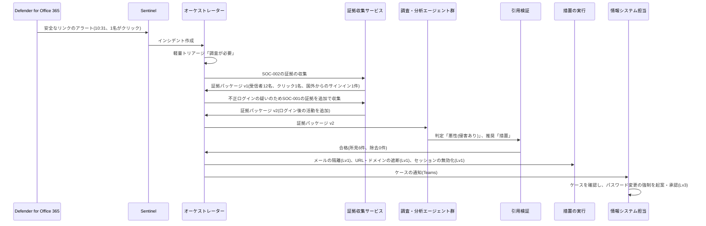

> **文書ID**: EXA-011
> **バージョン**: 0.1.0
> **改訂日**: 2026-11-08

# 実装例: フィッシング

[SOC-002](../../03-soc-runbooks/03-02-phishing.md) をA社で実行したときの流れを、架空の事案で示す。手順・重大度の補正・記録の定義はSOC-002に従う。
証拠の取得元は [EXA-007](07-evidence-sources.md)、措置の実行方法は [EXA-006](06-actions-and-protected-assets.md) を参照。

## 1. A社での補足

| 項目 | 内容 |
|---|---|
| トリガー | Defender for Office 365 のアラート(安全なリンク・安全な添付ファイル、なりすまし)、従業員からの報告(Outlookの報告ボタン) |
| 除外条件 | 外部の訓練サービスによる模擬訓練メール(ウォッチリスト `PhishingSimulation`)、取引先からの定期的な一斉送信(送信元の登録による) |
| 重大度の補正の追加 | 取引先を装った請求書・振込先の変更依頼のメールで、経理担当が受信者に含まれる場合は、影響度を中以上とする(SOC-002の「送金詐欺の疑い」の具体化) |
| 夜間・休日 | メールの隔離・URLの遮断はLv1として実行する。セッションの無効化は、対象が1件ならLv1、2件以上は夜間・休日はLv3(`PA-02`) |

> **カスタマイズ:** 取引先を装うメールの典型(請求書、振込先の変更、図面の送付)は、受信の傾向を見て除外条件と補正に反映すること。

## 2. 事案の流れ(架空)

平日10:12、取引先を装った「図面の改訂のお知らせ」というメールが、本社と工場の12名に届いた。本文のリンク先は、
Microsoft 365のサインイン画面を模した偽ページだった。

## 3. ケースの例

AIが情報システム担当に渡したケース([AI-006](../../02-agentic-ai/02-06-evidence-grounded-investigation.md) 第8章の順序)。

**カバレッジギャップ**

| 証拠項目 | 状態 |
|---|---|
| 添付ファイルの実行 | 確認済み・該当なし(添付ファイルなし) |
| 受信者のうち工場の共用PCを使う3名のURLへのアクセス | 確認済み・該当なし(`UrlClickEvents`、`CommonSecurityLog`) |
| ログイン後の活動(v2で追加。SOC-001の証拠項目) | 確認済み・該当あり |

**判定区分と推奨**: 悪性(侵害あり)。推奨は措置(SOC-002 手順2・3・5)とエスカレーション(重大度の仮判定 High)。

**所見(抜粋)**

| # | 所見 | 引用 |
|---|---|---|
| F-1 | 同じ送信元・件名のメールが12名に配信された | `E-02`(受信者一覧) |
| F-2 | 受信者1名(営業部)が10:31にリンクをクリックした | `E-03`(`UrlClickEvents`) |
| F-3 | 同じアカウントで、10:34に国外のIPアドレスから多要素認証を満たしたサインインがあった | `E-05`(`SigninLogs`) |
| F-4 | 10:41に、外部宛てに転送する受信トレイのルールが作成された | `E-08`(`OfficeActivity`) |
| F-5 | リンク先のドメインは、受信の2日前に登録されたものだった | `E-07`(脅威インテリジェンス) |

v1でF-3のサインインが見つかったため、オーケストレーターはSOC-002 第5章の規定(不正ログインが確認された場合はSOC-001を併用)に従い、
SOC-001の証拠項目を追加した v2 を作成した。F-4はv2の項目を引用している。

F-3は、攻撃者が中間者型の偽ページでセッションを奪った可能性を示す。多要素認証が満たされていても侵害を否定できない。

**推奨する次の手順**

1. 受信トレイのルールの削除(証拠を保全した後に、人間が実行する)
2. パスワード変更の強制(オンプレミスのActive Directoryで実行。Lv3、[EXA-006](06-actions-and-protected-assets.md) 第1章)
3. 転送先に送られたメールの範囲の特定(取引先の図面が含まれる場合は [EXA-021](21-external-reporting.md) の判定へ)

## 4. 措置と判断

| 時刻 | 措置 | 実行主体 | 権限レベル | 結果 |
|---|---|---|---|---|
| 10:36 | 12名の受信箱からのメールの隔離 | 措置の実行関数 | Lv1(IoC 1件) | 成功 |
| 10:36 | 偽ページのドメインの遮断(Defender・Exchange Online・FortiGateの遮断リスト) | 措置の実行関数 | Lv1(IoC 1件) | 成功 |
| 10:37 | 営業部の1名のセッションの無効化 | 措置の実行関数 | Lv1(対象1件) | 成功 |
| 10:52 | 受信トレイのルールの削除 | 情報システム主担当 | ―(AIが実行しない操作: 削除) | 成功。削除前にルールの内容を証拠パッケージ v3 として登録 |
| 10:58 | パスワード変更の強制 | 主担当が起案、副担当が承認 | Lv3 | 成功 |
| 11:20 | 重大度をHighと判定、CSIRT発動 | 情報セキュリティ責任者 | ― | 転送されたメールに取引先の図面が含まれるかを調査 |

## 5. この事例から分かること

- **多要素認証は侵害を否定する根拠にならない。** 中間者型のフィッシングでは、多要素認証を満たしたサインインが記録される。
  SOC-001・SOC-002の除外条件に「多要素認証を満たしている」を入れてはならない。
- **Lv1で初動を止め、影響の大きい措置は人間が行う。** AIはメールの隔離・遮断・セッションの無効化までを数分で実行し、
  パスワードの変更とルールの削除は人間が行った。要員が2名でも、初動対応時間目標(High: 1時間以内 `P-05`)を満たせる。
- **Entra ID P2がない場合の補完。** リスクベースの条件付きアクセス(P2)がないため、サインインのリスクによる自動のブロックはできない。
  国外からのサインインを条件付きアクセスで制限(出張の申請に基づく例外)し、SOC-001の検知で補う。
