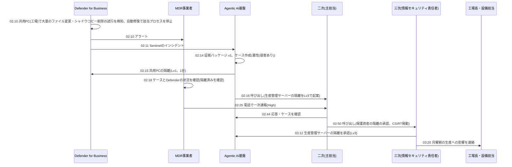

> **文書ID**: EXA-012
> **バージョン**: 0.1.0
> **改訂日**: 2026-11-08

# 実装例: ランサムウェア(前兆の検知から復旧まで)

[SOC-004](../../03-soc-runbooks/03-04-ransomware-precursor.md) と [CSIRT-011](../../04-csirt-playbooks/04-11-ransomware.md) をA社で実行したときの流れを、
休日の夜間に起きた架空の事案で示す。要員が少ない組織で、MDR事業者・AI・社内のオンコールがどう分担するかを示すことが目的である。

## 1. A社での補足

| 項目 | 内容 |
|---|---|
| 身代金の方針 | 支払わない。社長が導入時に決定し、取締役会に報告済み([CSIRT-011](../../04-csirt-playbooks/04-11-ransomware.md) 第2章のカスタマイズ) |
| 除外条件 | Azure Backupのジョブ(実行時間帯と対象のサーバー)、BitLockerの有効化の作業(Intuneの構成プロファイルの適用時) |
| 重大度の補正の追加 | 生産管理システムのサーバー、または制御系セグメントへの通信が確認された場合は、影響度を大とする(工場の生産が止まるため) |
| 夜間・休日 | 端末の隔離は、1台ならLv1、2〜3台ならLv2(MDR事業者が確認)。保護資産(生産管理システムのサーバーなど)の隔離はLv3で、情報セキュリティ責任者が承認する |
| バックアップ | 生産管理システムとドメインコントローラはAzure Backup(変更不可・論理削除あり)。SharePoint・OneDriveはファイルの復元機能とMicrosoft 365のバックアップ機能 |

## 2. 事案の流れ(架空)

日曜日の深夜。工場は稼働しておらず(土曜22:00に停止)、社内に要員はいない。

## 3. ケースの例(02:14 作成、v1)

**カバレッジギャップ**

| 証拠項目 | 状態 |
|---|---|
| 制御系の機器の端末のイベント | 未確認(ログソース未接続) |
| 同じセグメント内の、Defender未導入の機器との通信 | 未確認(ログソース未接続) |
| 生産管理システムのアプリケーションのログ | 未確認(ログソース未接続) |
| 情報系と制御系のセグメント間の通信(FortiGate) | 確認済み・該当なし(基準時刻の前72時間に、許可された連携以外の通信なし) |
| バックアップの状態 | 確認済み・該当あり(直近のジョブは成功、コンテナーへの削除の操作なし) |

**判定区分と推奨**: 悪性(侵害あり)。推奨は措置(SOC-004 手順2: 共用PCの隔離、生産管理サーバーの隔離)とエスカレーション(重大度の仮判定 High。
生産管理サーバーへの補正により影響度は大の可能性あり)。

**所見(抜粋)**

| # | 所見 | 引用 |
|---|---|---|
| F-1 | 共用PCで、02:06から02:10の間に1,800件のファイルの拡張子が変更された。OneDriveの同期フォルダも含む | `E-01`(`DeviceFileEvents`) |
| F-2 | 02:09に、共用PCでシャドウコピーを削除するコマンドの実行が試行された | `E-01`(`DeviceProcessEvents`) |
| F-3 | 共用PCへの01:52のリモートデスクトップのログオンの接続元は、生産管理システムのサーバーだった | `E-03`(`DeviceLogonEvents`) |
| F-4 | 生産管理システムのサーバーには、01:20にVPNの接続元のアドレスからログオンがあった | `E-03`(`SecurityEvent`、`DeviceLogonEvents`) |
| F-5 | 01:05に、FortiGateのローカルアカウント(設備ベンダーの保守用)で国外のIPアドレスからVPNの接続があった。このアカウントはEntra IDとのSAML連携の対象外で、多要素認証がない | `E-03`(`CommonSecurityLog`) |

**制約事項**: 統合エージェントの「制御系への横展開の痕跡はない」という所見は、制御系の機器の端末のイベントが「未確認」のため、
引用検証で除去した([AI-006](../../02-agentic-ai/02-06-evidence-grounded-investigation.md) 第7章「該当なしの根拠」)。セグメント間の通信が「確認済み・該当なし」であることだけを所見に残した。

**推奨する次の手順**

1. 生産管理システムのサーバーの隔離(保護資産のためLv3)
2. 設備ベンダーの保守用VPNアカウントの無効化(FortiGateの設定のため、人間が実行)
3. 制御系の機器の現地での確認(設備担当)

## 4. 措置と判断

| 時刻 | 措置・判断 | 実行主体 | 権限レベル | 補足 |
|---|---|---|---|---|
| 02:10 | 不審なプロセスの停止 | Defender for Business(自動修復) | ―(製品の自動修復) | 判断ログに記録([EXA-006](06-actions-and-protected-assets.md) 第5章) |
| 02:15 | 共用PCの隔離 | 措置の実行関数 | Lv1(1台) | SOC-004 第7章の規定により、検知端末のEDRのログだけで根拠が検証済み |
| 02:16 | 生産管理サーバーの隔離を起案 | オーケストレーター | Lv3(保護資産) | 二次のオンコールを呼び出し |
| 02:50 | 保守用VPNアカウントの無効化 | 二次(主担当) | ―(人間が実行) | FortiGateの管理画面で実行 |
| 03:12 | 生産管理サーバーの隔離 | 措置の実行関数 | Lv3(情報セキュリティ責任者が承認) | 承認は電話の後、Teamsの承認カードで記録 |
| 03:15 | CSIRT発動、インシデント対応事業者に依頼 | 情報セキュリティ責任者 | ― | サイバー保険の事故受付に連絡 |
| 03:20 | 月曜6:00の生産開始を保留 | 情報セキュリティ責任者、工場長 | ― | 制御系の確認が済むまで |

## 5. 封じ込めから復旧まで

| フェーズ | 作業 | 担当 |
|---|---|---|
| 封じ込め | 外部からのVPN接続を全面的に停止し、FortiGateのローカルアカウントを棚卸し(SAML連携の対象外のアカウントを無効化) | 主担当 |
| 封じ込め | ドメイン管理者・Entra IDの管理者アカウントのパスワードの変更(攻撃者がサーバーで認証情報を取得した可能性があるため) | 主担当、副担当 |
| 検知・分析 | 生産管理サーバーのディスク・メモリの保全と解析。外部への送信量の確認(二重恐喝の可能性) | インシデント対応事業者 |
| 検知・分析 | 制御系の機器の現地での確認(月曜5:00〜)。設備監視用のPCの状態、PLCのプログラムの改変の有無 | 設備担当、設備ベンダー |
| 復旧 | 共用PCの初期化と再展開(Intune)。OneDriveのファイルを暗号化の前の時点に復元 | 副担当 |
| 復旧 | 生産管理サーバーは、解析の結果、改ざんの痕跡がないため隔離を解除(解除は情報セキュリティ責任者が判断)。念のためAzure Backupの金曜日の復元ポイントを検証環境に復元して比較 | 主担当、保守事業者 |
| 復旧 | 月曜10:00に生産を再開。復旧後2週間は、生産管理サーバーとVPNのアラートを優先して扱う | 工場長、主担当 |

外部報告・外部連携(警察への相談、取引先への通知、個人情報の漏えいの判定)は [EXA-021](21-external-reporting.md) 第3章の例を参照。

## 6. この事例から分かること

- **夜間の初動はMDR事業者とAIのLv1で足りるが、保護資産の判断には社内の人が要る。** 共用PCの隔離は検知から5分で済んだが、
  生産管理サーバーの隔離は承認まで約1時間かかった。保護資産の隔離は、夜間に誰が承認するかを事前に決めておく必要がある
  ([EXA-006](06-actions-and-protected-assets.md) 第4章)。
- **「未確認」を「該当なし」と書かせない仕組みが、制御系の確認を促した。** 引用検証が「制御系への横展開なし」を除去したため、
  現地での確認を行ってから生産を再開する判断になった。
- **侵入経路は、多要素認証の対象外のアカウントだった。** SAML連携で多要素認証を必須にしても、保守用に作ったローカルアカウントが残っていると、
  そこが侵入経路になる。保護資産の棚卸し(`P-24`)とあわせて、VPNのアカウントを棚卸しする。
- **変更不可のバックアップが復旧の前提になる。** バックアップのコンテナーに削除の操作がないことを、ケースの冒頭で確認できた。
