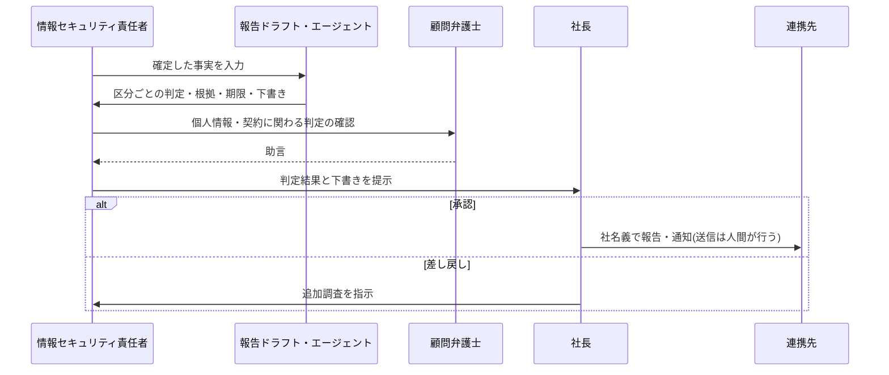

> **文書ID**: EXA-021
> **バージョン**: 0.1.0
> **改訂日**: 2026-11-08

# 外部報告・外部連携

[GOV-003](../../01-governance/01-03-external-reporting-flow.md)(外部報告フロー)と [CSIRT-002](../../04-csirt-playbooks/04-02-external-coordination.md)(外部関係者との連携)を、A社に当てはめる。
「判定は自動、発信は人間」という基本方針と、AIが送信しないこと([AI-002](../../02-agentic-ai/02-02-authority-levels.md) 第4章)は変えない。

## 1. 役割

| GOV-003の役割 | A社での担当 |
|---|---|
| CSIRT(インシデントマネージャー) | 情報セキュリティ責任者 |
| 報告ドラフト・エージェント | Agentic AI基盤の報告ドラフト・エージェント(下書きをSharePointの制限されたサイトに保存する。送信の機能はない) |
| 構成会社責任者(最終承認・報告の実施) | 社長 |
| グループCISO | ―(情報セキュリティ責任者が兼ねる) |
| 法務・広報 | 顧問弁護士(法務部門はない)、総務課(広報の窓口) |

## 2. 判定基準と連携先

GOV-003 第3章の判定基準(個人情報の漏えい等、業法、契約、社会的影響)に、A社の連携先を加える。

| 区分 | 判定基準 | 連携先 | 期限 | 判断する人 |
|---|---|---|---|---|
| 個人情報の漏えい等 | GOV-003 第3章の基準。A社では従業員・退職者の人事・給与情報が主な対象 | 個人情報保護委員会、本人 | GOV-003 第3章の期限 | 社長(顧問弁護士と協議) |
| 取引先との契約上の通知 | 取引先から受領した図面・技術資料の漏えいの可能性、または納品に影響する生産の停止 | 該当する取引先の窓口 | 契約の定めによる(取引先ごとに一覧で管理) | 社長 |
| 犯罪の疑い | ランサムウェア、不正アクセス、送金詐欺 | 都道府県警察のサイバー犯罪相談窓口 | 速やかに | 情報セキュリティ責任者(社長に報告) |
| サイバー保険 | 保険の対象となる可能性のある事故 | 保険会社の事故受付 | 約款の定めによる | 情報セキュリティ責任者 |
| 情報共有 | 他組織への注意喚起が有益な手口・IoC | JPCERT/CC、IPA(届出)、業界団体の情報共有の窓口 | 任意 | 情報セキュリティ責任者 |
| 委託先からの通知 | MDR事業者・インシデント対応事業者・保守事業者が、A社のデータに関わる事故を知った | 委託先からA社へ | 契約で定める(速やかに) | ― |

> **カスタマイズ:** 取引先ごとの通知の基準・期限・窓口は、契約書を確認して一覧(SharePointリスト)にまとめ、報告ドラフト・エージェントの判定ルールに登録すること。
> 連絡先(警察の窓口、保険会社の事故受付、各事業者の緊急連絡先)は、紙の連絡網にも記載する(メールやTeamsが使えない事態に備えるため)。

## 3. 判定の例

[EXA-011](11-runbook-phishing.md)、[EXA-012](12-runbook-ransomware.md) の架空の事案での判定結果。

| 事案 | 区分 | 判定 | 根拠 |
|---|---|---|---|
| フィッシング(EXA-011) | 取引先との契約上の通知 | 該当(通知する) | 転送されたメールに、取引先から受領した図面の添付ファイルが含まれていた |
| フィッシング(EXA-011) | 個人情報の漏えい等 | 非該当 | 転送されたメールに含まれる個人情報は取引先の担当者の氏名・連絡先(数十件)で、GOV-003の基準のいずれにも当たらない。顧問弁護士が確認 |
| ランサムウェア(EXA-012) | 犯罪の疑い | 該当(相談する) | 不正アクセスとランサムウェアの実行 |
| ランサムウェア(EXA-012) | サイバー保険 | 該当(連絡する) | 03:15に事故受付に連絡し、インシデント対応事業者の派遣を依頼 |
| ランサムウェア(EXA-012) | 取引先との契約上の通知 | 該当(通知する) | 月曜の生産開始を4時間遅らせたため、納品の遅れの可能性を通知 |
| ランサムウェア(EXA-012) | 個人情報の漏えい等 | 判定を保留し、解析の結果で確定 | 人事・給与情報は影響を受けたサーバーにないが、外部への送信量の解析が終わるまでは「漏えいのおそれ」を否定できない。速報の期限を考慮し、解析の終了予定日を記録 |

最後の例のように、証拠が足りないときは「非該当」と判定せず、確定に必要な証拠と期限を記録する。これは調査の判定保留([AI-006](../../02-agentic-ai/02-06-evidence-grounded-investigation.md) 原則6)と同じ考え方である。

## 4. 流れ

GOV-003 第4章のフローのうち、グループCISOの段階を除く。

